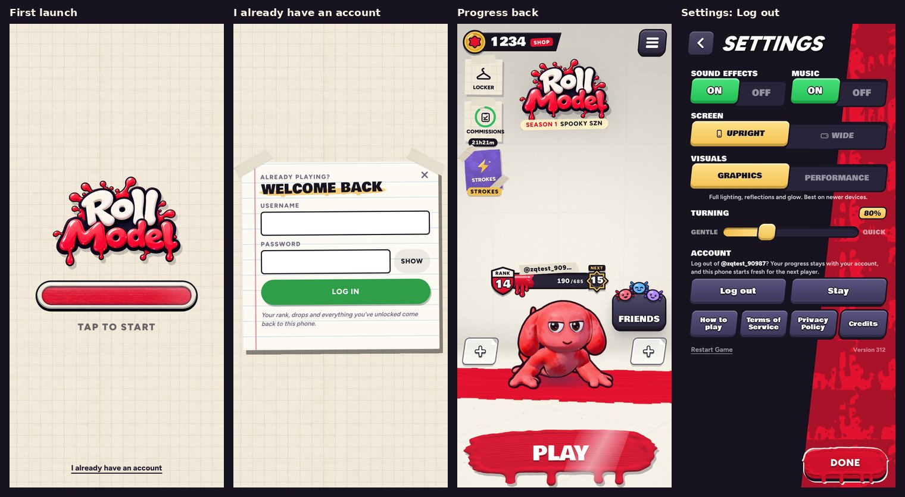

# v312: your progress goes with your account

## 1. "I already have an account"

- On a first launch (a new phone, a fresh install, or after Log out), "I already have an account" sits at the foot of the loading screen, from about halfway through loading.
- A first launch now ends on "Tap to start", with the link under it. Before, the app went straight into the intro, so there was no time to tap anything.
- The link opens the Log in sheet over the loading screen ("Already playing? Welcome back"). It has Log in only, with "Your rank, drops and everything you've unlocked come back to this phone."
- After logging in, your progress comes back: rank, drops, everything bought, crafted and unlocked, the lessons done. The game starts again with it and goes past the intro and the lessons into the lobby: "Welcome back, @you! Your progress is back."
- Once a phone is signed in to an account, the link isn't shown.
- An account with no progress saved yet says so: "There's no progress saved with this account yet. Open Roll Model signed in on the phone you played on, and it saves it there. Then try again here." It offers Try again and Start fresh. Start fresh goes on to the intro, signed in.

## 2. Log out

- Settings › Account › Log out now asks first: "Log out of @you? Your progress stays with your account, and this phone starts fresh for the next player." The buttons are Log out and Stay.
- It saves your progress to your account, then starts the phone fresh: back to the loading screen with "I already have an account", ready for someone else to log in or start their own. Sound, music, graphics and screen orientation stay with the phone.
- If your progress can't be saved (offline, say), nothing changes: you stay signed in, and it says so.
- Restart Game is as before. It asks with a second tap, then starts the game over on this phone. Logging in again afterwards brings the account's progress back.

## 3. Progress kept with your account

- While you're signed in to an account, a copy of your progress goes to it about half a minute after something changes, and at once when the app is put away.
- A phone already signed in sends its first copy the first time it opens v312.
- A phone with progress of its own (never signed in to an account) warns before logging in from Settings: "Logging in brings your account's progress to this phone, in place of the progress on it now."
- Your sign-in, sound, music, graphics and screen orientation are never sent. They belong to the phone.

## 4. Two phones on one account

- Every start checks the account's copy against the phone's:
  - If the other phone moved on and this one didn't, this one takes the account's copy: "Your progress from your other phone is here."
  - If both moved on, the one with more rank wins.
- The server never lets a copy with less rank replace one with more, so a phone that was left behind can't wipe out progress.

## 5. One step for you: the SQL

Paste `supabase/migrations/20261016000000_saves.sql` into Supabase › SQL Editor › New query, then press Run. It's safe to run again.

Until it's run:
- logging in still works, but brings no progress back;
- Log out keeps this phone's progress, as before.

## Tested

- **The database:** 7 new tests, 22 in all, on a local Postgres with the real SQL:
  - only real accounts keep progress;
  - what goes up comes back;
  - less rank never replaces more;
  - only an object, up to 200 kB;
  - your copy is yours alone;
  - deleting the account deletes its copy;
  - 240 saves an hour at most.
- **The game** against a local stand-in for Supabase running the same SQL (never the real project):
  - a signed-in phone sends its progress at start, and later changes follow;
  - a fresh phone shows the link while loading, waits on "Tap to start", and opens the sheet over the loading screen;
  - a wrong password says so; the right one brings the progress back and skips the intro, with the welcome;
  - Log out asks (Stay keeps you signed in), saves first, then starts the phone fresh with the link;
  - an account with nothing saved says so, and Try again brings the copy once the other phone has saved it; Start fresh goes on into the intro, signed in;
  - a phone left behind takes the account's newer copy at its start, and its own copy with less rank is refused;
  - a phone with its own progress shows the warning on Log in, then takes the account's progress.
