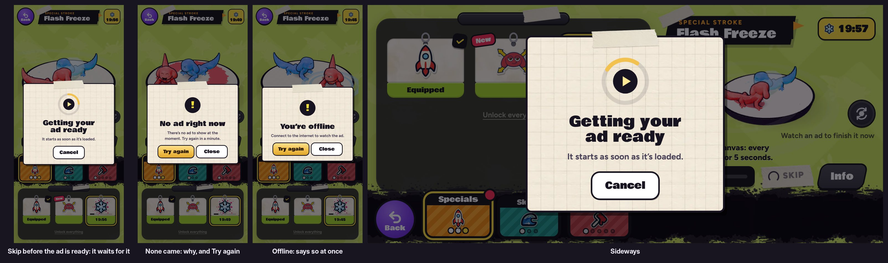

# v335: the ad for Skip is ready sooner, and a card waits for it when it isn't

## 1. The ad is got ready as the Abilities page opens
- The app now loads a rewarded ad as soon as the Abilities page opens. Before, it only did once a stroke was being crafted, so a Skip right after starting one often came before the ad.
- It loads the next one after each ad is watched, while the page is open.

## 2. A card waits for an ad that isn't ready yet
- **The ad is ready:** Skip plays it at once. The card only comes up if the ad hasn't started within half a second.
- **The ad isn't ready yet:** a taped paper card says "Getting your ad ready", with a spinner round the ad's play mark and **Cancel**. The ad plays the moment it's loaded, over the card.
- **While it's slow,** the game asks the app again. The app keeps an ad that loads late, so the next ask plays it at once. It keeps trying for up to about 20 seconds (four asks).
- **If none comes,** the card says why, with **Try again** and **Close**. This replaces the old "No ad to show right now" toast.
  - You're offline: "Connect to the internet to watch the ad." This one shows at once, with no asking again.
  - The ad didn't load: "It took too long. Try again in a moment."
  - No ad right now: "There's no ad to show at the moment. Try again in a minute."
- **Cancel** (or Escape) closes the card and tells the app to stop waiting, so the ad doesn't pop up later. The stroke keeps crafting.

## 3. In the app
- **AdsBridge.swift** takes a new `cancel` message: the wait ends, and an ad still loading is kept for next time. An older app build just ignores it.
- The browser's five-second stand-in is unchanged.
- **These changes reach the phone with the next TestFlight build.** The game is bundled inside the app.

## Tested
In the preview build, with a stand-in answering as AdsBridge does, upright and sideways (21 checks each, all pass):
- An ad is asked for as the page opens, even with nothing being crafted, and again after one is watched.
- Ready at once: it plays and the card never shows.
- Never answers: the card waits. Cancel and Escape each close it, tell the app, and leave the stroke crafting.
- Slow, then there: the game asks again and the ad plays over the card. The stroke is crafted.
- No ad: four asks, then "No ad right now" with Try again and Close.
- Offline: says so at once. Try again plays one and crafts the stroke.
- The browser stand-in is unchanged. No page errors.

The v321 ad checks: two now differ by design, because "no ad" and "offline" show the card instead of the toast. One other misses on the build before this change too: its timing doesn't hold in this test environment.

The Swift change couldn't be compiled here, since there's no Xcode. It is three lines that use only what the file already has.

The release's load-time check counted one more WebGL warning than before, a texture format mismatch reported once while loading. The v332 and v334 releases show the same warning in this test browser now, so it comes from the test setup, not from this change. The other release checks passed.
