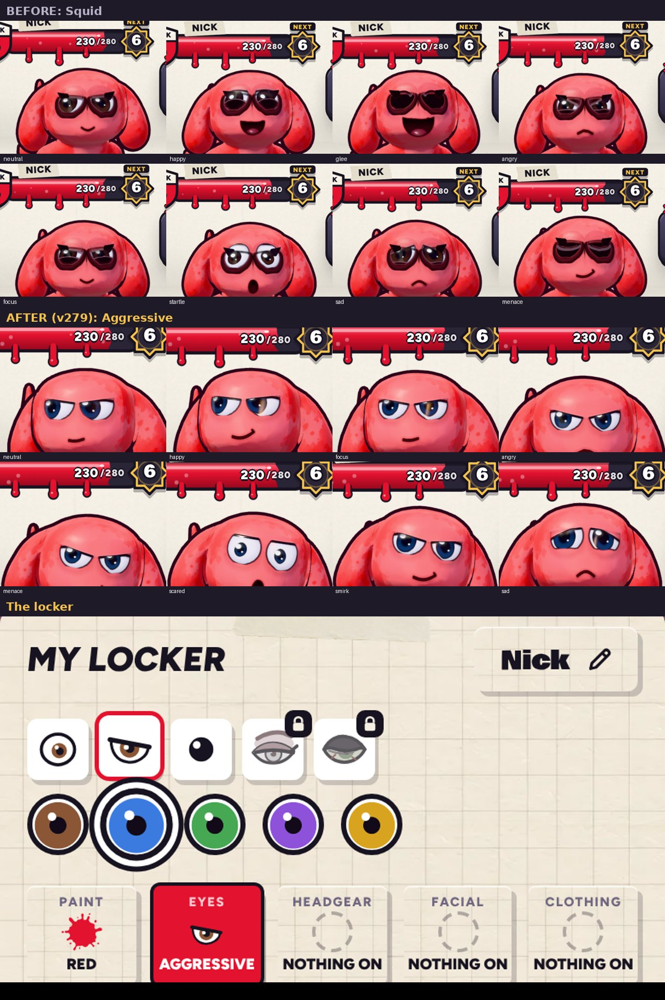

# Aggressive eyes (v279)

The Squid eye style is now called **Aggressive**. Its save key stays `edgy`, so anyone wearing it keeps it. Built in
`tools/v279_aggressive.py`.

## The look

- The old almond eyes with thick ink rims and a point at the corner (they read as sunglasses) are gone.
- A heavy upper lid lies straight across each eye, slanting down toward the middle of the face, like the reference.
- Under the lid: a dark lash line and a little shadow on the eye. Above it: the lid's edge catching the light.
- The eyes are a little wider, and the big iris sits high under the lid with its catchlight, so it always looks like it's
  sizing you up.
- Done in the face shader, so every iris colour and paint colour works.

## The personality: always wants to win

- **The lids stay down nearly always.** Whatever mood the game gives it, the lid stays heavy. Focus, menace and angry pull it
  lower and steeper.
- **The exceptions:** a startle or a fright lifts the lid so the eyes open up a bit, and sad flips the slant. Eyes that shut
  (dozing, yawning, a sneeze, a dizzy spin, bracing) still shut.
- **It doesn't smile.** Its resting mouth is a new firm flat line, drawn on a tenth row of the face sheet (with a fanged twin).
  Every happy mood (happy, glee, content, cute, the wink-smirk, mid-leap) becomes the crooked smirk from the victory screen.

## Also

- The name changes to Aggressive in the locker, the Paint Shop, and the intro's eye picker.
- The locker icon is redrawn: an eye under a heavy slanted lid.
