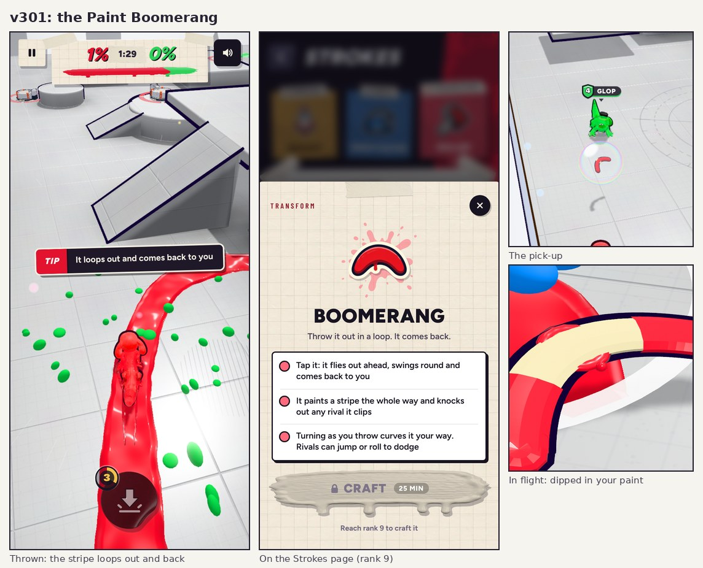

# v301: the Paint Boomerang

A new pick-up. Tap its button to throw it.

## What it does

- It flies out ahead, swings round in a loop and comes back to you. It paints a stripe the whole way, wider than your trail.
- Turning as you throw curves it your way. Thrown at a rival just ahead, it leans in on them.
- Any rival it clips, going out or coming back, is knocked out ("Boomeranged!").
- How to dodge one: jump over it or dodge-roll through it. A giant swats it away.
- It rides up over low walls and turns back at a tall one. If you're knocked out before it gets home, it drops and splats where it
  is. You catch it with a pop.
- It's a cream boomerang with tips dipped in your paint, so it stands out on any floor and on your own stripe.

## Where it shows up

- It spawns with the other pick-ups, about as often as the Whirlwind.
- CPUs pick it up and throw it at whoever is ahead of them. They duck one as often as their level dodges a pound. Some CPUs start a
  match holding one.
- It's a start item on the Strokes page from rank 9 (25 minutes on the bench), with a painted sticker in the same style as the others.
- Tips: the first throw says "It loops out and comes back to you". The first time a rival's boomerang heads your way, a tip says to
  jump or swipe up.

## Checked in a match

- Thrown at a rival 7 m ahead, it knocked them out on the way out, came back and was caught. The stripe shows in the shot above.
- A CPU threw one at the player: standing still got knocked out. Jumping when it was 5 m away cleared it.
- The pick-up bubble, the item button ("Boomerang" with its icon), the Strokes card and its detail card all show correctly.
- The release boots clean.
