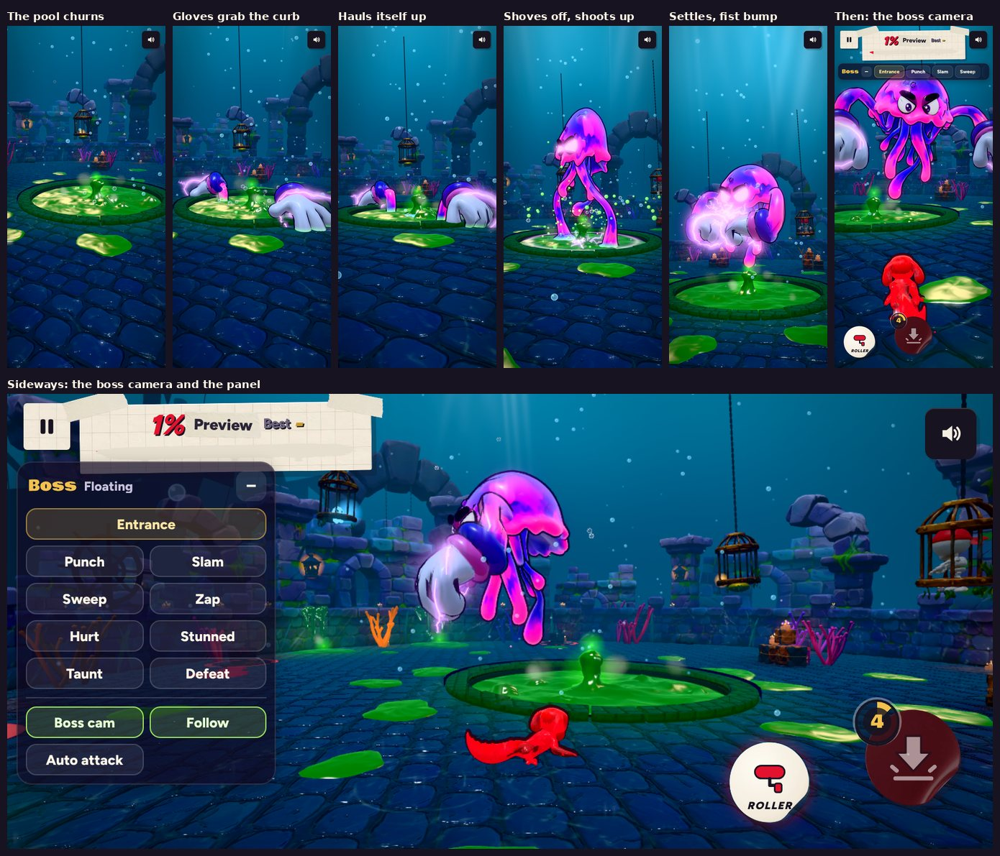

# v315: the boss demo in the Sunken Keep

Choose Event › Season Conquest now opens the boss demo: the Sunken Keep with the boss in it. Until now the stage and the boss were only in test pages. From this version they're in the game.

## 1. The entrance

After the sweep over the stage, the boss makes its entrance with its own camera. It takes about 7 seconds:

1. The pool churns and spits slime.
2. Both gloves burst up out of the slime, one on each side, and slam down on the pool's curb, taking hold.
3. It hauls itself up between them in two heaves, eyes first, the slime pouring off it, shaking with the strain.
4. It crouches, then shoves off the curb with one great beat of its bell and shoots up past where it floats, the gloves trailing under it.
5. It flares out at the top, settles to its height, and bumps its fists together in a burst of sparks.

Then comes the usual countdown and Go.

## 2. How it moves

- It floats over the arena like a jellyfish. The bell's pulse bobs it up and down.
- It also really moves. Each beat of the bell is a push, followed by a glide that the water slows down. The bell tips in the direction it's going.
- It stays near the pool, drifting toward your side of it, never more than about 3.4 from the middle. It turns to watch you.
- A slow current keeps it from ever hanging dead still.
- When it has further to go, it beats faster.

## 3. The boss camera

While you play, the camera stays behind you on the line from the boss through you, looking between the two of you. You and the boss are both in the picture whichever way you roll.

- Your steering is the same as ever: it turns you, and the camera keeps to the line.
- Near the wall, the camera comes in closer and a little higher, so it never goes through the wall.
- It eases in after Go. **Boss cam** in the panel turns it off, and the usual camera comes back.

## 4. The panel

Upright, the panel is a strip under the top bar that scrolls sideways. Sideways, it's a small panel at the left.

- **Entrance** plays the entrance again, with its camera. You're held still while it plays.
- **Punch, Slam, Sweep, Zap** are aimed at you. A fist, the slam's shockwave, the zap and the sweep knock you back: a bump and a tumble, never a knock-out.
- **Hurt, Stunned, Taunt** play those states.
- **Defeat** makes it drift back over the pool, deflate and sink. It comes back up by itself a few seconds later.
- **Follow** turns its swimming after you on or off. Off, it stays over the pool.
- **Auto attack** makes it pick a move on you every few seconds.
- The panel shows the move playing, and folds down to its title with the button in its corner.

Pause › Menu leaves the demo and lets the boss go.

## Under the hood

- The boss can now leave the pool's middle. Its floor, the pool's hole and where its gloves land when stunned all go by where the pool really is.
- It takes its swim (a lean, a roll and a beat rate) from the demo.
- The entrance is a new move, `emerge`.
- `boss-pack.txt` (the boss model, about 0.95 MB) ships beside the game. It's fetched only when the demo opens.
