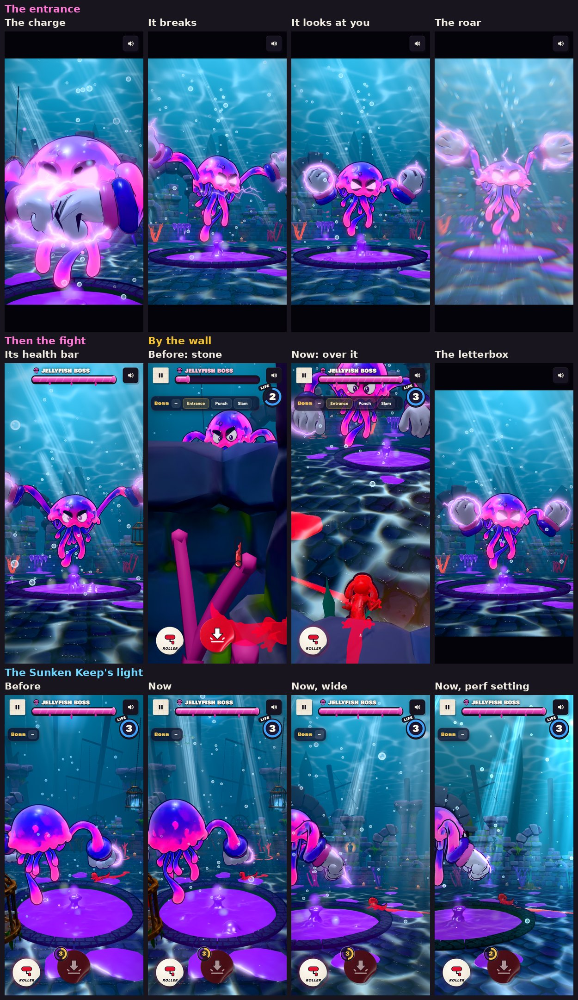

# v319: the Jellyfish Boss's entrance, the fight's polish, and the Sunken Keep's light

Once the boss is out of the pool, it now charges up, looks at you and roars. The fight starts with the screen shaking, a screen effect and then its health bar. The fight around it is polished too, and the Sunken Keep has new light and life.

## The new end of the entrance

1. **It comes out of the pool**, as before. The pool churns, the gloves burst out and grab the curb, and it hauls itself up and shoots out of the slime. Black letterbox bars slide in at the top and bottom as the entrance starts.
2. **The charge (about 1.5 s):**
   - It turns a little away and brings its fists together in front of its bell, pressing them and trembling.
   - Sparks of energy stream in to its fists from all round. Its gloves crackle more and more, its eyes glow and its bell tightens and beats fast.
   - The camera comes round in front of it, low, looking up at it, and creeps in.
   - Then the energy breaks in a burst of sparks, with a flash, a ring and a moment of the picture splitting.
3. **It looks at you (about 1.5 s):**
   - The camera cuts to over your shoulder, low, looking up into its face, and creeps closer.
   - It turns round to face you, lowers its fists and leans in, eyes narrowed. Its eyes catch the light once.
   - The water goes quiet: one deep heartbeat and a dark swell.
4. **It roars, and the fight starts:**
   - It rears back, then throws itself forward: arms flung wide, bell flared, tentacles whipping, slime and bubbles flying.
   - **The screen shakes** hard and the camera is knocked back. The letterbox bars snap away.
   - **The screen effect:** a flash, speed lines rushing in toward it, a ring racing out, and the edges flushed with its pink. On the hi graphics setting the picture also splits into colour and smears toward it. A shock ring races out over the floor.
5. **Then its health bar:**
   - It drops in, and its name stamps in.
   - It fills with the boss's paint, with a shine running along it, and flashes when full.
   - Then the countdown, as before.

The entrance plays the same way when you replay it from the panel and when the boss comes back up after a defeat.

## The fight's feel

- **When it knocks you:** a split-second freeze, a kick of the camera and a jolt of the colour split.
- **When it's hurt:** a split-second freeze.
- **A strike or a mine blowing near you:** a jolt of the colour split.
- **Low on health:** under 30%, a red glow pulses round its bar.
- **Its defeat:** its last flinch plays in slow motion with a flash and the screen effect. **Boss defeated!** stamps in over the middle with a win sting.
- **The camera by the wall:** pressed against the keep's wall, there was no room behind you. The boss camera ended up outside the wall, low, looking at stone.
  - Now, as the camera nears the wall, it rises over the kelp and coral that line it.
  - Past the wall, it goes up over it, high enough to see you over its top, and higher still at one of its pillars. It stays on the line from the boss through you.
  - When you and the boss can't both fit, upright you're kept clear of the buttons at the bottom, and the lens widens a little (up to 10 degrees) to keep more of the boss in.

## The Sunken Keep's light

- **Light shafts:** soft beams of light falling through the water, in groups of wide and narrow ones.
  - They sway, slowly brighten and fade, and have faint specks drifting inside them.
  - They're brightest high up, fade toward the floor, and fade when the camera comes close.
- **Where they land:** the floor brightens under the brightest beams, moving as they sway.
- **The surface far above:** a soft web of light ripples overhead, fading toward the horizon.
- **Specks and bubbles:**
  - Marine snow drifts all round you and now and then glints.
  - Streams of bubbles rise from cracks at the foot of the wall.
- **Life beyond the wall:**
  - Schools of fish circle the keep with beating tails, and a small orange one circles just inside the wall, high up.
  - A manta glides past far off (hi setting only).
  - Rock spires, mounds and broken towers stand far out all round, fading into the water.

The perf graphics setting has fewer of each and a gentler version of each effect.

- **The spout is gone:** the column of goo that stood in the middle of the pool, with the glow at its top and the mound round its foot. The pool still bubbles, steams and glows, and the boss still rises from its middle.

## Performance

The boss demo was measured on both graphics settings, idle, during Slime rain, during Sea mines and at the roar, against v318:

Draw calls and triangles per frame, upright, v318 then v319:

| | Idle | Slime rain | Sea mines | The roar |
|---|---|---|---|---|
| **hi** v318 | 81 draws, 293k | 82, 290k | 87, 322k | 85, 312k |
| **hi** v319 | 77 draws, 288k | 73, 275k | 81, 299k | 82, 314k |
| **perf** v318 | 77 draws, 276k | 78, 283k | 73, 296k | 79, 272k |
| **perf** v319 | 72 draws, 266k | 65, 248k | 68, 270k | 83, 295k |

These move by a few either way with where the camera and the boss are, so read them as about the same. Frame times on the test machine's software renderer were the same or lower for v319 in each case. The new stage light on its own, with everything else held the same, adds about 7% to drawing time on hi and 2% on perf; software rendering exaggerates that kind of cost.

- **The new stage light is cheap:**
  - The shafts, the specks and bubbles, and the fish, manta and rocks are three draws in all, every part moving on the graphics chip.
  - The old bubbles were moved one by one in JavaScript every frame and sent to the graphics chip again. They're gone.
- **The screen effect is drawn only while it plays.** It's one full-screen pass over the frame. On hi, the colour split and smear are a branch in the last pass, skipped when the effect is off.
- **The HUD's moving parts no longer repaint the page every frame.**
  - The paint flowing along the health bar and the red pulses of low health and the last life now move and fade on the compositor.
  - Before, the bar's flow repainted every frame the bar was up.
- **The hidden score strip isn't drawn.** The versus score strip's paint is a canvas drawn about 33 times a second. The boss demo hides the strip, so now it isn't drawn there.
- **No hitches on first use:** the screen effect and the moves' effects (rain, shock wave, ripples, strikes, mines) are made, and their shaders built, as the entrance starts, not on the frame each one first shows. The moves are drawn once through the frame's real passes, using the game's own warm-up, so the shaders made are the ones play uses. After that, a first rain, strike, mines, ripples or shock wave builds no new shader. Before, the first strike built five.

## Sounds

Made with Ludo and finished by `tools/boss_sfx_build.py`:

| When | Sound |
|---|---|
| The charge | A crackling power-up, swelling into the moment it breaks |
| The stare | One deep heartbeat (felt more than heard on a phone, which suits the hush) |
| The roar | A huge impact boom with a smash and a fizz, under the boss's roar |
| The bar filling | A thick paint gush ending in a sparkle |

## Reduced motion

There's no shake, speed lines, smear, split or sliding bars, just a softer flash. The low-health and last-life glows hold steady instead of pulsing.

## Tested

**The entrance, stepped frame by frame, upright and sideways, with pictures at each beat:**
- The charge, the burst, the stare and the roar each play at their moment.
- Their sounds play in order: the power-up, the burst, the heartbeat, the impact, the roar and the bar's gush.
- The screen effect plays on the burst and the roar.
- The bar drops in after the roar and fills, and then the countdown starts.

**In real time:**
- The letterbox comes in as the entrance starts. It's gone at the roar (9.3 s), before the bar shows (about 9.8 s), upright and sideways.
- Knocks, hurts and blasts each give the freeze, the camera kick and the colour split.
- Under 30% the bar glows red.
- The defeat plays in slow motion and stamps **Boss defeated!**

**The camera by the wall**, with you held in four spots:
- **A little in from the wall facing the boss, and nearer the middle facing the wall:** the camera is up over the wall. You're near the bottom, clear of the buttons, and the boss's face is at the top.
- **Pressed against the wall, and against one of its pillars:** it looks down over you, and you're in the picture above the buttons.

**The stage:**
- Pictures upright and sideways, on hi and perf, before and after.
- The pool without its spout, upright on hi and sideways on perf.

**Warm-up:** with the shaders counted before and after each move's first go from the panel (rain, strikes, mines, ripples, shock wave), none built a new one.

No page errors in any run.
