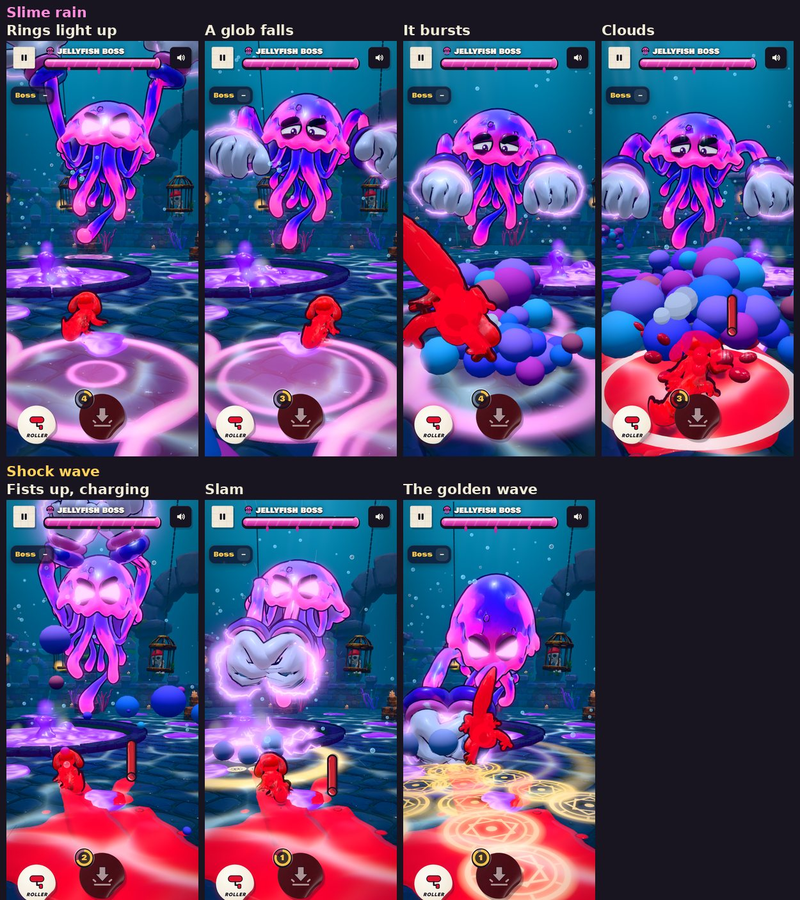

# v317: two new boss moves, Slime rain and Shock wave

Two area attacks for the Jellyfish Boss, after the reference pictures: warning circles on the floor that burst into big puffy clouds, and a trail of golden rune circles racing over the floor. Both are in the boss demo's panel, after Zap, and Auto attack picks them too.

## Slime rain

1. **Wind-up:** the boss swells and throws its gloves up high.
2. **Three spits:** it spits globs of slime high out of its bell, three hard beats one after another.
3. **Warning rings:** with each spit, rings light up on the floor:
   - first two anywhere in the arena;
   - then two near you;
   - then one where you're heading.

   Each ring is a glowing pink circle. Its fill grows out to the edge and it pulses faster as the time runs out.
4. **The fall:** in the last half second, a glob of purple slime drops into each ring.
5. **The burst:** each glob bursts into a cluster of puffy clouds (purple, blue, pink, lilac), with a flat shock ring spreading from it.
6. **The hit:** if you're inside a ring when its glob lands, you're knocked away (a bump and a tumble, as with the other moves; never a knock-out).

Clouds that come right up to the camera shrink away, so a burst on top of you never hides the screen.

## Shock wave

1. **Charge:** the boss raises both fists high together over its bell, a golden charge crackling in them.
2. **Slam:** it slams them down on the floor at the pool's edge on your side. There's a puff of stone dust and a golden shock ring, and if you're right next to it, you're knocked.
3. **The wave:** three lines of golden rune circles race out across the floor from the slam: one straight at you, one on either side. Each circle pops up, flashes, holds lit for half a second and fades.
4. **The hit:** touch a lit circle and you're knocked on, the way the wave is going.

## Sounds

Made with Ludo and finished by `tools/boss_sfx_build.py`:

| When | Sound |
|---|---|
| The rain's wind-up | A rubbery wind-up |
| Each spit | A wet pop with a rising whoosh |
| Rings lighting up | A soft warning shimmer |
| Each glob bursting | A wet boom with a fizz; two takes, played in turn |
| The golden charge | A rising shimmering hum |
| The slam | The boss's slam |
| The wave | A rolling run of glowing thumps |

## Tested

**Each move stepped frame by frame, upright and sideways, with pictures at each moment:**
- The three spits and their five rings: two anywhere, two near you, one where you're heading, all clear of each other.
- The globs falling and bursting, and the clouds.
- The slam, and the three lines of circles reaching out to the wall.

**Played for real, from the panel buttons:**
- Each move's sounds play in order.
- A ring landing where you are knocks you away.
- A lit rune circle knocks you, then waits before it can knock you again.

**The panel:** the two new buttons fit, upright and sideways.

**Leaving the demo:** its effects are let go. No page errors.
