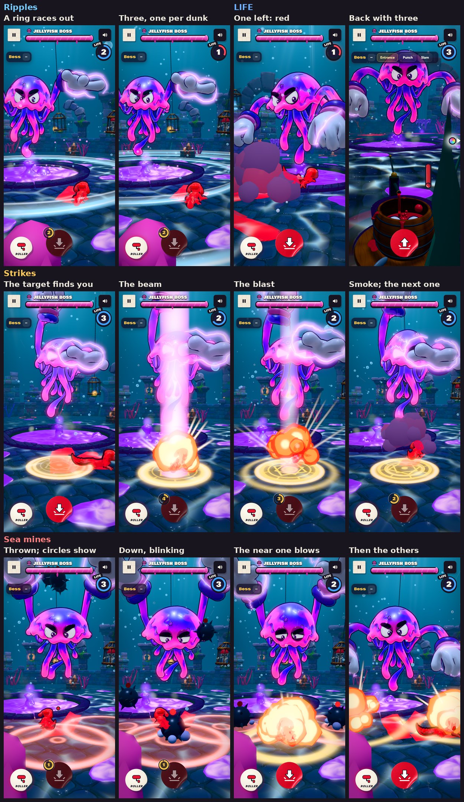

# v318: three more boss moves (Ripples, Strikes, Sea mines) and your LIFE

Three more attacks for the Jellyfish Boss, after the second pair of reference pictures: rings of water racing out over the floor, a golden target that follows you before a beam strikes down, and spiked bombs that land round you and blow. They're in the boss demo's panel after Shock wave, and Auto attack picks them too.

The pictures also showed a LIFE counter, so the demo has one now: three lives, as in the pictures.

## Ripples

1. **Wind-up:** the boss floats back over the middle of the pool and rears up.
2. **Three dunks:** it flops down into the slime three times, about two-thirds of a second apart, slapping it with its gloves.
3. **The rings:** each dunk sends a ring of water racing out over the floor to the wall. Each ring is a bright band on the floor with a low wall of light at its edge.
4. **The hit:** if a ring passes you while you're on the ground, you're knocked outward. Jump it and it passes under you.

## Strikes

1. **Charge:** the boss raises one glove high, crackling.
2. **The target:** a golden rune circle appears under you and follows you, running further and further ahead of you, until it's where you'll be when the beam comes down.
3. **Lock:** it stops, spins faster and blinks for about half a second.
4. **The beam:** a pink beam of light strikes down on it and it explodes. The blast has a flash, a fireball that cools into smoke, light rays and a golden shock ring.
5. **Three in a row:** the next target finds you straight away, three strikes in all. The boss pumps its fist at each one.

You never stop moving, so if you keep going the same way, the beam lands on you. Once the target locks, steer off your line to get out of it.

## Sea mines

1. **The throw:** the boss winds up both gloves and throws three spiked mines in high arcs:
   - one where you'll be when it lands;
   - two either side of your way, a little further on.
2. **Where they'll land:** as soon as they're thrown, a red blast circle marks where each one will come down.
3. **Down:** they land with a clunk and a puff of dust.
4. **Fuse:** each one's red light blinks and beeps, faster and faster, for about two seconds.
5. **The blast:** each one blows, and you're knocked if you're inside its circle. Go near one and it blows straight away.

Steer around the circles as soon as you see them.

## LIFE

- A round gauge under the sound button, with your lives in the middle: three to start.
- Each of the boss's hits takes one. The gauge shakes and loses a third of its ring; at the last one it turns red and pulses.
- After a hit you blink for a moment and nothing can hit you, so one attack can't take all three.
- At none, you're knocked out. The knock-out card reads **Splatted by Jellyfish Boss**.
- You come back with three.
- It's only shown in the boss demo, while you're playing or paused.

## Sounds

Made with Ludo and finished by `tools/boss_sfx_build.py`:

| When | Sound |
|---|---|
| Each ring of water | A deep rolling whoosh with a watery surge, over the boss's splash into the pool |
| A target finds you | A tense lock-on hum with ticking beeps |
| The beam | A crackling zap into a heavy boom |
| Each blast | A deep muffled boom with a burst of bubbles |
| A mine's light blinking | A short warning beep, higher and louder as the fuse runs down |
| The throw | A heavy whoosh |

## Tested

**Each move stepped frame by frame, upright and sideways, with pictures at each moment:**
- **Ripples:** the three rings race out to the wall. A ring that passes you on the ground knocks you.
- **Strikes:** the target follows you, then locks. Each beam lands where the target locked, then the blast, and the next target finds you. A strike on you knocks you.
- **Sea mines:** they fly with their circles already showing, then land, blink and blow. The one by you blows when you come near it; the others when their fuses run out.

**Played for real, from the panel buttons:**
- Each move's sounds play in order: the rings, the lock-ons, beams and blasts, the throw, the landings, the beeps and the blasts.
- Going on without steering, the strikes and the middle mine land on you. Ignoring all three rings of a Ripples takes two lives, not three, thanks to the blink after each hit.

**LIFE:**
- Three hits: 3, 2 (red at 1), then knocked out with "Splatted by Jellyfish Boss".
- Back with three when you come back.

**The panel:** the three new buttons fit, upright and sideways.

**Leaving the demo:** its effects are let go and the gauge hides. No page errors.
