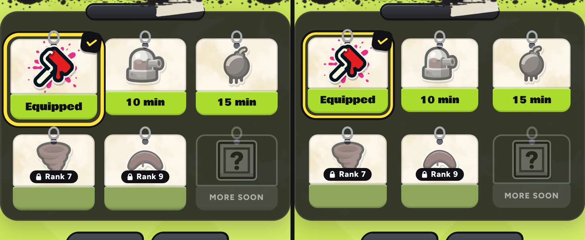

# v324: Strokes card spacing

On the Strokes page, the yellow ring on the selected card ran into the card beside it and the hooks of the row below. It also crowded the "Unlock everything" link and came close to the panel's edge. Now:
- **The ring** fits closer round the card and matches the tabs' ring (3px yellow with a 2.5px dark edge). The card grows a little (3%) from its middle. Before, it grew 6% downward from the hook and spilled into the row below.
- **The gaps between cards** are now 18px in both directions (they were 12px across and 14px down). The panel's side padding matches (16px, was 14px). The ring now has about 8px of clear space from the next card, the row below and the panel's edge.
- **"Unlock everything"** sits 4px further below the cards.
- **Sideways and on small phones**, the same rules apply. On phones under 360px wide, the gaps are 16px down and 14px across.

The cards are about 5px narrower to make room (97px on a 390px-wide phone, was 102px).

## Tested
In the preview build, measured and shot close up (at 3x) on 390px and 430px-wide phones, sideways, and on a 320px-wide phone:
- The ring is clear of every neighbour.
- The gaps are even.
- "Equipped" and the craft times still fit on the cards.
- No page errors.
