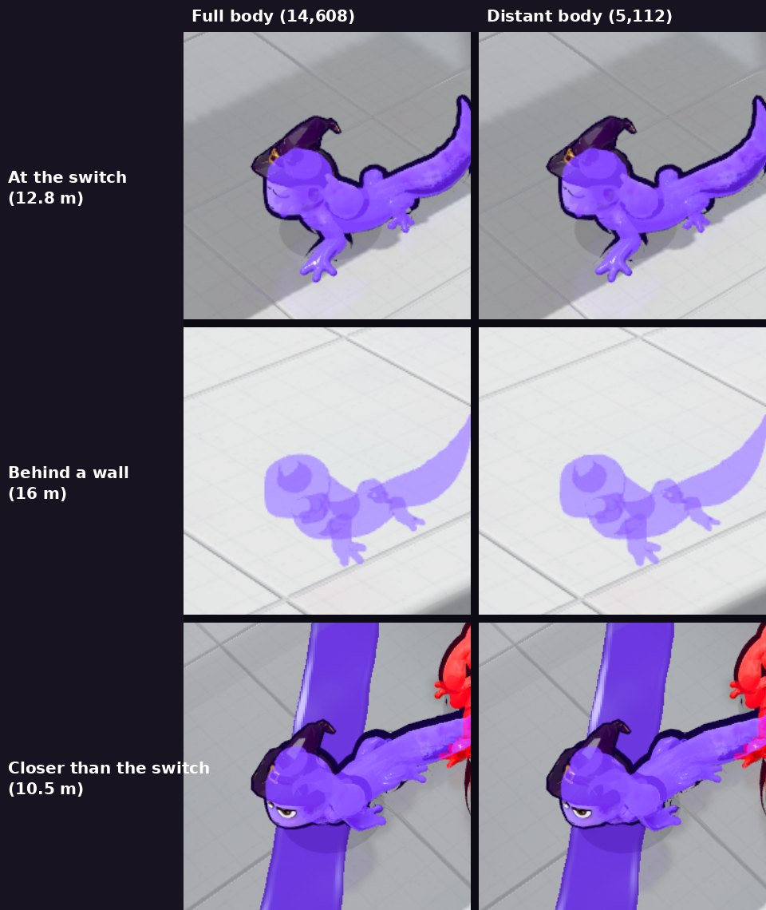

# v296: character levels of detail (standard and distant)

Two levels, picked each frame by how big a character is on screen.

- **Distant body:** the crawl body drops from 14,608 to 5,112 triangles (35%). It was made offline with meshoptimizer's simplifier
  (`tools/axo_lod_make.mjs`, stored in `tools/data/axo_lod_250.json`). It keeps the original vertices and only shortens the
  triangle list, so the skinning, face, paint, colours and UVs are exactly the same. A distant character draws its body, ink
  outline, see-through silhouette and shadow from it.
- **Distant animation:** a distant character's pose (gait, ears, tail, face, skinning) updates 30 times a second. Its position and
  heading still update every frame, so it moves smoothly across the screen.
- **When it switches:** a rival goes distant below about 52 screen points per metre (about 13 m from the camera in portrait, closer
  in landscape where everything is smaller) and comes back a little nearer than that, so it never flickers at the line. Giants
  count as bigger. Your own character is always full detail, and so is everyone in the menus, the locker, the versus portraits,
  the kill cam and the victory screen. If a future pack doesn't match the stored counts, everyone just stays full detail.

Measured in a four-player Showdown (simulated phone, Graphics mode):

| | before | now |
|---|---|---|
| Character triangles per frame (body, outline, silhouette, shadow) | 234k | 120k (-49%) |
| Character animation time per frame, same match, back to back | 1.46 ms | 0.90 ms (-39%) |

Side by side at the switch distance (and closer), the two bodies are practically identical even magnified.
