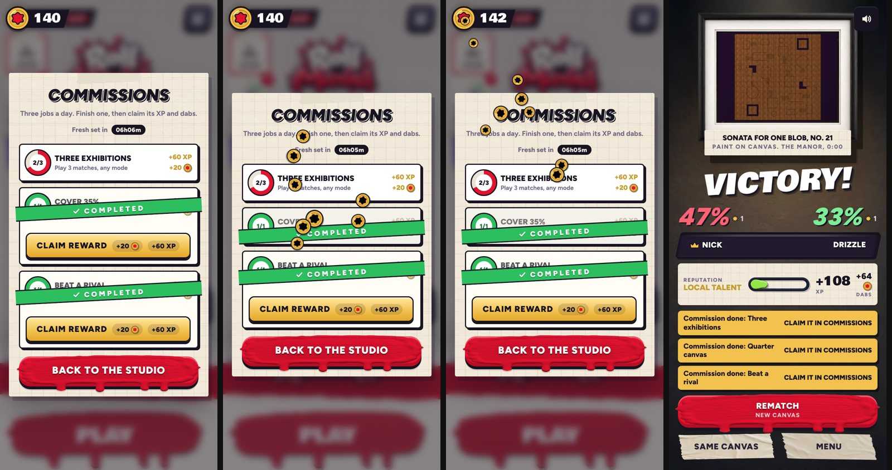

# Commission rewards you claim (v276)

A finished commission's XP and dabs used to be added at the end of the match. Now they wait on its card until you claim them.
Built in `tools/v276_claim.py`.

- **The ribbon**: open Commissions and each newly finished job gets its green Completed ribbon slapped on, one after another
  (0.45 s apart), each with its own sound: a quick whoosh into a two-note bell chime, made with Ludo (`game/sfx/ribbon.mp3`).
- **Claim reward**: a gold button pops up under the ribbon with what it pays (+20 dabs, +60 XP).
- **The coins**: tap it and ten dabs burst off the button, each on its own arc up into your dabs counter, which is lifted over
  the panel's dim for as long as the panel is open (a copy of it in the same place). The count goes up a clink at a time, with a Ludo
  coin burst on the tap (`sfx/coins.mp3`), a Ludo clink per landing coin (`sfx/coin.mp3`, rising in pitch), a pop of the counter on the
  last one, and +60 XP floating off the button. The button turns to Claimed and folds away; the card is a finished one.
- **The lobby**: the Commissions badge counts the rewards waiting to be claimed and pulses.
- **The end of a match**: "Commission done: ... Claim it in Commissions" (it no longer adds them to the match's pay).
- **Saves**: jobs finished before v276 were paid at the time, so they show as claimed. A reward still unclaimed when the day's set turns
  over is paid then rather than lost.
- The three sounds are their own small files, fetched and decoded the first time they're wanted (when a reward is waiting); until
  they're in, the game's own pop and power sounds stand in.
