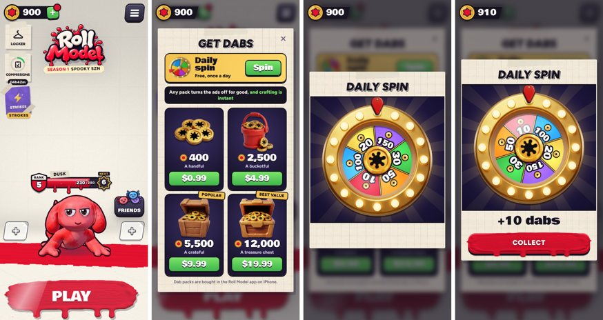

# v381: dabs to buy, a daily spin, ad-free, and a short ad now and then

## What's new

- **The +.** A green + at the end of your dabs, where the Shop tag was, opens **Get dabs**. Tapping the count still opens the Paint
  Shop. The Locker and Paint Shop page has a + beside its counter too. A red dot on the + means today's free spin is waiting.
- **Four packs**, bought with Apple's in-app purchase (shown in the player's own currency):

  | Price | Dabs | Dabs per dollar |
  |---|---|---|
  | $0.99 | 400 | 404 |
  | $4.99 | 2,500 | 501 |
  | $9.99 | 5,500 (Popular) | 551 |
  | $19.99 | 12,000 (Best value) | 600 |

  How these were set: everything for sale costs 12,930 dabs. That's 10,330 for the outfits (the season's finds once found) and 2,600 for
  the strokes. A match pays about 30 to 60, so buying it all by playing takes roughly 290 matches. The $19.99 pack buys almost all of it,
  and each pack down gives a little less per dollar.
- **Any pack makes the game ad-free for good.** There's no more short ad. The Giant's craft is instant, and Skip on a craft already
  running needs no ad. This is kept in the save, so it follows a signed-in player to a new phone.
- **The daily spin**: free once a day, from midnight on the phone's clock. It pays:

  | Dabs | Chance |
  |---|---|
  | 10 | 40% |
  | 20 | 28% |
  | 30 | 15% |
  | 50 | 10% |
  | 100 | 5% |
  | 150 | 2% |

  That's about 27 dabs on average, less than one match. It's a reason to come back, not a stand-in for a pack.
- **The wheel** uses Ludo's art:
  - a gold rim whose bulbs blink faster while it turns,
  - a red pin that flicks at each slice,
  - a gold hub you tap to spin,
  - light rays turning behind it.

  The winning slice flashes and confetti falls. The dabs are added and saved the moment the wheel starts, so closing the app mid-spin
  loses nothing and doesn't give a second spin.
- **The spin and ads**: for a player who hasn't bought dabs, about one day in three the short ad plays before the wheel turns. It's
  decided once a day, so closing and reopening the wheel doesn't change it. It never comes on the very first spin, or within 10 minutes
  of another ad, and only if one is already loaded. It also starts the matches' ad count again. Bought dabs: never.
- **The short ad**:
  - It plays once every 10 to 20 matches (a new number each time), after Play and before you pick what to play.
  - It's an AdMob interstitial, set to pictures only.
  - It shows only if one is already loaded, so nobody waits for it.
  - It never shows in the tutorial, or to anyone who has bought dabs.
  - Any rewarded ad watched (the craft's Skip) starts the count again, so two ads never come close together.
- **The Friends button** is a size smaller.

## For the app

- `PurchaseBridge.swift` (new) handles purchases with Apple's StoreKit 2. A purchase is finished with Apple only after the game has
  added the dabs and saved, and each purchase is added once.
- `AdsBridge.swift` gains the interstitial.
- `RollModel.storekit` lets purchases be tried in Xcode.
- The setup steps (App Store Connect products, the AdMob interstitial unit, App Privacy) are in `ios/RollModel/README.md`.

## Tested

- 34 checks, all passing. They cover:
  - the + and its dot;
  - the four packs and their prices;
  - a browser saying packs are bought in the app;
  - the spin: it pays what the wheel shows, once a day, with the right odds over 20,000 draws;
  - purchases through a stand-in for the app: Apple's price shown, +2,500 dabs, ad-free, the app told to finish, the same purchase
    handed over twice and added once, and Ask to Buy;
  - the short ad: not before it's due, loaded a match ahead, shown after Play with the events waiting until it closes, the events
    opening anyway when none is loaded, and the count restarting after a rewarded ad;
  - no ad or dot in the tutorial.
- The regression checks and v371's iPhone Duo fold checks pass on this build.
