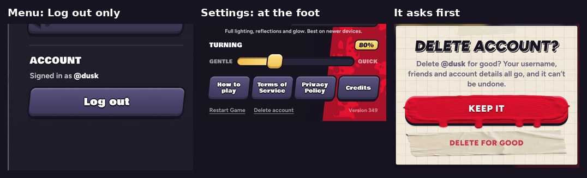

# v349: Delete account is deeper, in Settings

- **The menu's Account section no longer has Delete account.** Signed in, it shows who you are and **Log out**, which still asks first.
- **Delete account is a small link at the foot of Settings,** beside Restart Game. It only shows while you're signed in.
- **It asks first,** in a card over Settings:
  - "Delete account?", with who it is: "Delete @you for good? Your username, friends and account details all go, and it can't be undone."
  - **Keep it** is the big button and the one that's selected. **Delete for good** sits under it, in red on a strip of tape.
  - Keep it, a tap outside the card or Escape closes it, and Settings stays open.
- **While it deletes,** the button says "Deleting…" and both buttons wait.
  - Once it's done, the card says "Account deleted" with OK, and the link goes.
  - If it can't be deleted, the card says why and you stay signed in.
- **The Terms and the Privacy Policy point to Settings for it again** ("Settings › Delete account").

## Tested
In the preview build, on a 390px-wide phone and sideways. 15 checks, all pass:
- **Where it shows:**
  - Signed out, Settings has no Delete account.
  - Signed in, the menu shows Log out only.
  - Signed in, Settings shows Delete account at its foot beside Restart Game, on screen upright and sideways.
- **The card:** it asks first, with your name, and Keep it is selected.
  - Keep it closes it, keeps you signed in and leaves Settings open.
  - So do Escape and a tap outside the card.
- **If it fails** (a failure made up for the test): the card says why and stays, and you stay signed in.
- **If it works** (the server call stood in for, since the preview can't reach the account server):
  - "Deleting…", then "Account deleted" and OK. The link goes.
  - OK goes back to Settings.
  - The menu then offers Make an account and Log in again.
- **The Terms and the Privacy Policy** say Settings.
- **No page errors.**
