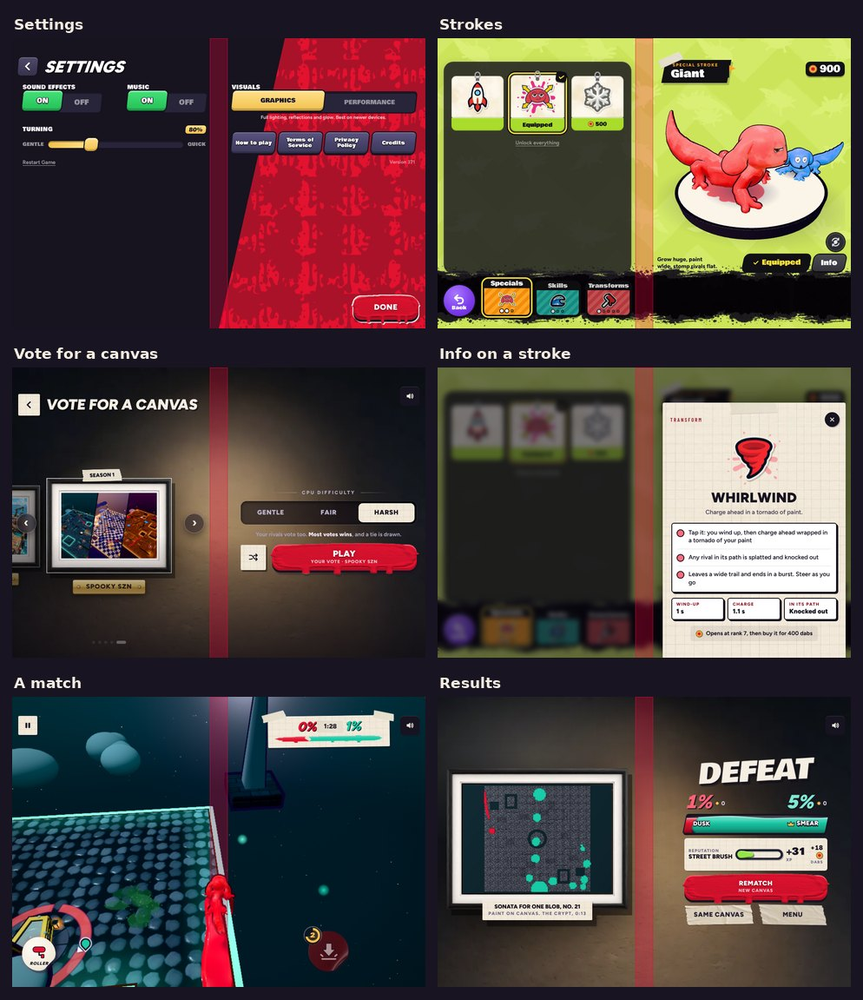

# v371: iPhone Duo partly folded, and strokes you have are "Learned"

## Boxes and words keep to one side of the fold

While iPhone Duo is partly open, its fold runs down the middle of the open screen (held wide: a left and a right screen) or across it
(held upright: a top and a bottom one). Nothing the player reads or taps sits on the fold now.

- **How the game knows:** the app reads where the fold runs from iOS (UIView's reserved regions, iOS 27.1: the active "division"
  region) and tells the game, checking twice a second and on every layout, and sending only when it changes. It calls the iOS 27.1 API
  by name, so the project still builds with an older SDK, where nothing changes. A browser with viewport segments is read the same way.
  Opened flat (the fold's region inactive), closed, or on any other phone, nothing changes.
- **Held wide (the user's "left or right screens"):**
  - Pop-ups come up in the right-hand screen, where iPhone Duo puts the view on top (Apple's overlay arrangement): Info on a stroke,
    Commissions, Stats, the account sheets, Terms, How to play, the pause card (its rows stacked to fit), Ol' Bloop's cards, the ad's
    wait, the nudge about notifications, a new item's card, the loading screen.
  - Pages in two parts split at the fold: Settings (sound, music and turning on the left; visuals and the links on the right), the
    Strokes page and the Locker (the cards on the left, the stroke or your character on the right), Friends (you on the left, the list
    on the right), Choose Event (two cards each side), the vote for a canvas and Spooky SZN (the pictures on the left, difficulty and
    Play on the right), and the results (the painting on the left, the score on the right).
  - In a match, what sat in the middle moves to the right-hand screen: the score and clock, the banners ("Paint it red!"), the pound
    button, the countdown, the missile warning, the knocked-out badge, tips, the versus card's line, and the tally. The winner's name
    stops short of the fold.
  - The lobby's rank bar sits right of the fold instead of on it; toasts sit in one screen; in the intro, the title goes right of the
    fold and the two send-off lines one each side (its cards already sit top left).
- **Held upright:** pop-ups, the tally and the loading screen come up in the lower screen (scrolling if taller); the lobby's rank bar,
  the results' painting and the vote's pictures stay above the fold, difficulty and Play below it; Choose Event puts two cards above and
  two below; the Strokes page and the Locker end their picture at the fold and start the tabs after it; Friends puts you above and the
  list below.
- **Still across the fold:** the 3D view itself (the canvas, the characters) and what follows a character around it (a rival's name, your
  paint tank), as the game world does; the versus card's two halves meet at the fold.

## "Learned"

A stroke you've bought with dabs, or crafted (the Giant), is "Learned":

- the info card's pill says Learned (it said Yours for a bought one, Crafted for the Giant); the starters still say Yours;
- the line under it says "Learned: it’s yours";
- buying one says "Learned! Flash Freeze is your special stroke" (it said "Bought! ..."), and the Giant's craft finishing (or Skip)
  says "Learned! The Giant is yours"; Ol' Bloop's lesson says "Learned! Tap Equip to make it your special stroke";
- VoiceOver reads a tag as learned (it said owned). The lock-screen nudge when a craft is done still says "The Giant is ready!".

## Tested

- **The fold** (66 checks, in a browser with the fold handed to the game as the app sends it, at iPhone Duo's open size, 951 x 669 wide
  and 669 x 951 upright, with its safe areas): without a fold nothing is marked and Info on a stroke sits in the middle; with the fold
  down the middle, 17 screens and pop-ups, the lobby, a match, the pause card, the tally, the victory screen and the results have
  nothing across the fold (buttons, words, pictures and boxes; what a scrolling row or a frame clips away doesn't count), with the
  cards and the stroke either side on the Strokes page, the vote's pictures and its Play either side, Settings' middle gap at the fold,
  and the score, the pound button and the pause card in the right-hand screen; opened flat, it all goes back. Held upright, the same 17
  screens have nothing across the fold, with Info in the lower screen, the Strokes tabs below the fold and the rank bar above it. A
  browser's viewport segments set the fold too. No page errors. Separately: Settings with the account rows (signed in) splits at the
  fold too, and a fold report measured for another screen size (a moment old, during a turn) is ignored until the new one comes.
- **Learned:** buying Flash Freeze says "Learned! Flash Freeze is your special stroke" and its line "Learned: it’s yours"; the crafted
  Giant says Learned; the Rocket (a starter) still says Yours; a tag reads out learned.
- **The iOS app:** there's no Swift compiler here, so the fold reading (DeviceBridge.swift, GameViewController.swift) is checked by hand
  against Apple's documentation; try it in the iPhone Duo simulator by folding it partway on the Strokes page or in a match.
- **The earlier tests** pass on this build: the v352 checks (25 of 25), v351's two (26 of 26, 7 of 7), v355's (27 of 27) and v354's
  (25 of 25), and the dashboard's end-to-end (38 steps) and live tests (13 steps).
