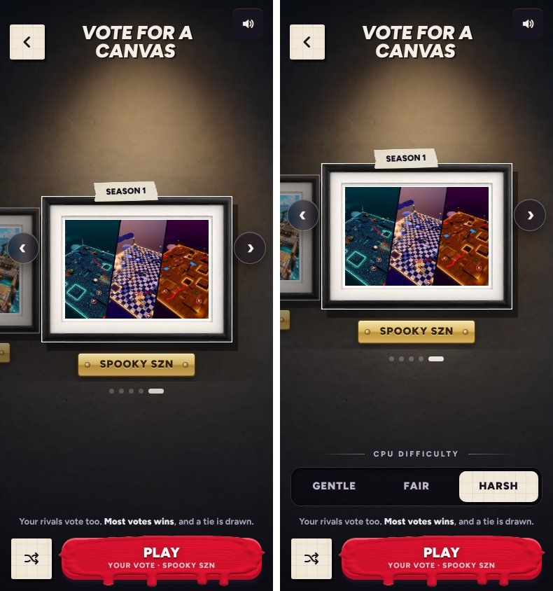

# v378: the second match is always on easy, with no difficulty to pick

## What it does now

- The second match is the first one after the lesson, played once the locker lesson is done. In it the CPUs always play on easy,
  whatever difficulty was saved.
- The difficulty isn't shown anywhere for that match:
  - not on the vote page (its heading and switch are gone),
  - not on the lobby's Canvases card ("1v1", not "1v1 · CPU fair"),
  - not on the versus card before the match.
- A second match left part way through is still the second match next time.
- Once the second match has been played to the end, the saved difficulty comes back (medium for a new player). The vote page then shows
  the switch again.

## Tested

- 11 checks, all passing:
  - before the second match: easy, nothing shown, and a tap on the hidden switch does nothing;
  - in it: the CPUs play on easy;
  - after it: the saved difficulty (hard in the test) and the switch are back;
  - a player past the tutorial: unchanged.
- The regression checks and v371's iPhone Duo fold checks pass on this build.
