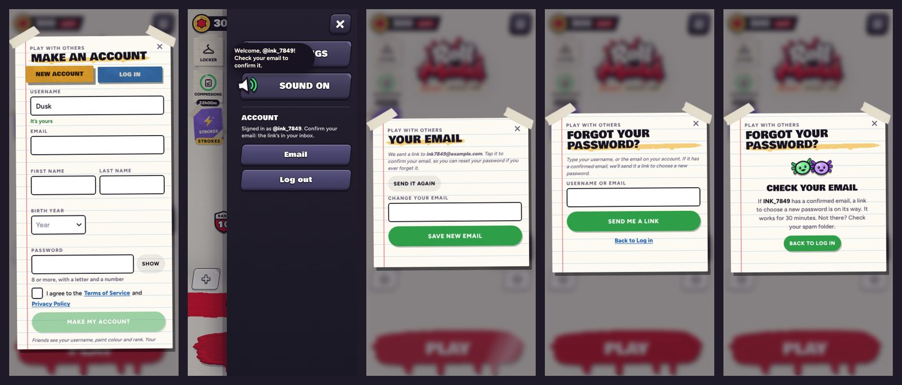
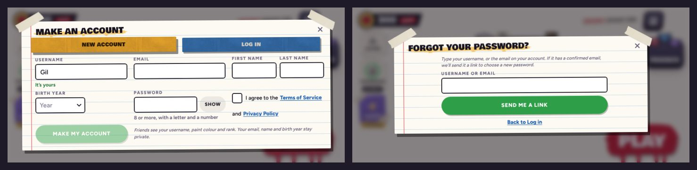

# v355: account emails, and Forgot password

- **New account asks for an email.** It's private: other players never see it, and players still log in with their
  username. The button stays off until the email looks right (the field says why).
  - Once the account is made, the email is saved and the welcome email goes out: "Welcome to Roll Model", the username,
    and a button to confirm the email (it works for 24 hours).
  - An email already used by another account, or one the server refuses: the account is still made, and the form says
    to type another one and press the button again.
  - One switch in the code (`EMAIL_REQ`) makes the email optional instead.
- **Log in has "Forgot password?"** It opens its own page, Forgot your password?: type a username or an email, and if
  that account has a confirmed email, a reset link goes to it (it works once, for 30 minutes). The page never says
  whether an account exists, and allows one try every 30 seconds.
- **The menu's Account section** says to add an email or to confirm it, and has an **Email** button: Your email shows
  where the link went, sends it again, and changes the email.
- **The links in the emails open the website** (`site/`): confirm.html confirms the email, and reset.html sets a new
  password and signs the player out everywhere. Then a "your password was changed" email follows.
- **The Privacy Policy says what the email is for** (the account only: the welcome, reset links, and a note when the
  password changes; no newsletters, never shared) and that Resend sends the emails. Accounts made from now on record
  agreeing to this version.
- **Sideways, every page of the account sheet fits:** New account takes three columns, and the email fields look like the
  others. On small screens the sheet keeps to the screen and scrolls, and an error scrolls into view with the button.

## Before it does anything
Run `supabase/migrations/20261019000000_email.sql`, then switch sending on (Resend key in Supabase Vault, the website and
addresses): see `admin/README.md`, Email. Until the SQL is run, accounts are still made but the email typed at sign-up
isn't kept (the menu asks for it later), Your email says "Coming soon" and Forgot password says resets are coming soon. Until sending is switched on, players' addresses are saved
but nothing is sent (Send it again works once it's on).

## Tested
Against the real database code (both migrations on a local Postgres behind `supabase/tests/standin.mjs`), with the emails
caught instead of sent: 27 of 27 checks pass.
- New account: the Email field, a bad or missing email keeps the button off, a good one turns it on; the account is made,
  its email saved unconfirmed, and the welcome email carries the username and a confirm link.
- The menu says to confirm; Your email shows where the link went; Send it again sends a second one.
- The confirm link confirms it, and Your email then says so.
- Forgot password: its own page with no tabs; the same answer for a real and an unknown account; a reset email only for
  the real one; the reset link sets a new password, the "password changed" email follows, and the new password logs in.
- A taken email: the account is made, the form asks for another, and the second try saves it and sends the welcome.
- Without the email SQL, the account is still made. No page errors anywhere.
- `supabase/tests`: 53 of 53 pass (9 of them for the emails: tokens, expiry, single use, rate limits, the templates).
