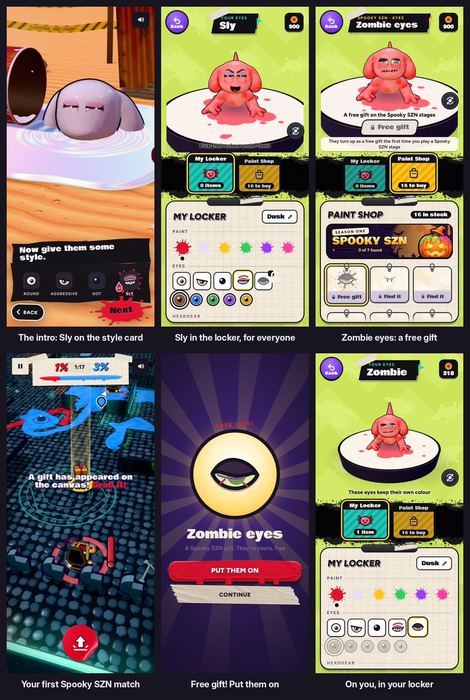

# v330: Sly eyes from the start, Zombie eyes a free gift

## Sly eyes: yours from the start
- **In the intro,** "Now give them some style." offers Round, Aggressive, Dot and Sly.
- **In the locker,** Sly sits with the other styles, unlocked for everyone.
- **In the Paint Shop,** Sly isn't for sale any more.

## Zombie eyes: the one style to find, and free
- **When:** the first time you play a Spooky SZN canvas (The Crypt, The Cathedral or The Manor), a gift box turns up on the floor:
  - early in the match;
  - a little ahead of you;
  - with "A free gift!", Ol' Bloop's "Grab it!" and the arrow to it.
- **Roll over it** and the Zombie eyes are yours. They cost nothing.
- **After the match,** a card says Free gift! with Put them on:
  - **Put them on** puts the eyes on you and opens your locker on them.
  - **Continue** goes on to the results.
- **If you miss it,** it turns up again the next time you play a Spooky SZN canvas.
- **Until then,** the shop and the locker show them as a Free gift and say where they come from.

## Also
- **The second lesson match** (Sludge Sewer) no longer hands out the Zombie eyes after the rain.
- **The third lesson match:** if it's on a Spooky SZN canvas, the gift waits until halfway, after the orb's lesson.
- **Online matches** don't have the gift.
- **Other canvases:** the Zombie eyes never turn up there. Their other finds come as before.
- **Older saves:**
  - If you had found the Zombie eyes but never bought them, they're yours now.
  - If you bought the Sly eyes, you keep them, and the dabs aren't refunded.
- **The note** under the button on the locker page now sits on a paper slip, so it reads over the pad's dark rim.

## Tested
In the preview build, on a 390px-wide phone and sideways, 54 checks, all passing:
- **The locker:**
  - Sly is unlocked, and a tap puts it on and saves it.
  - Sly isn't in the Paint Shop.
  - The Zombie eyes say Free gift, with how to get them.
  - The locked Zombie style shows them in the shop.
- **The first Spooky SZN match:**
  - The gift is planned early and turns up near you with Ol' Bloop's word.
  - Rolling over it makes the eyes yours, free.
  - The card says Free gift! and Put them on, which puts them on and opens your locker on them.
- **Where the gift doesn't come:** not on Blank Canvas or Sludge Sewer, not after the second lesson's rain, and not online.
- **The third lesson match:** the gift comes halfway.
- **The intro, played through:** Sly is on the card, picking it puts it on, and it carries into the lobby.
- **Older saves** are handled as above.
- **No page errors.**
- **Earlier suites:**
  - The v328 tap checks (13) still pass.
  - The v327 locker checks pass apart from four:
    - Two expected the old flow: Sly locked, and the zombie-deal shop.
    - The other two came after the Sly step, and failed only because the test was then on the wrong tab. Re-run from the shop tab, the try-on still works.
