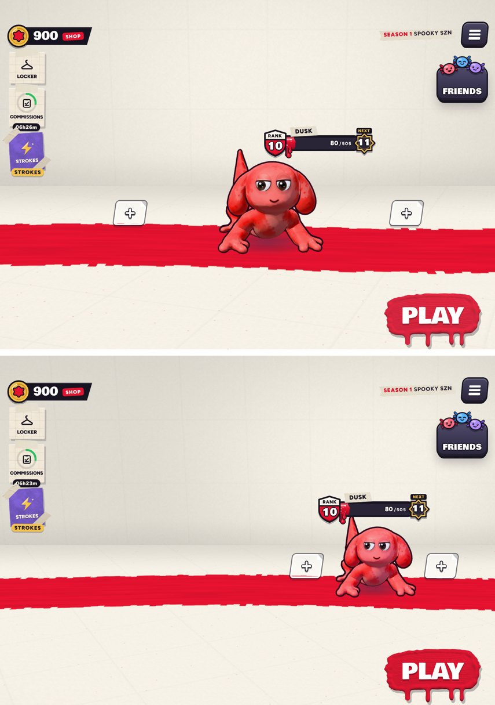

# v377: on iPhone Duo held wide and partly folded, you stand on one side of the fold

## What was wrong

- The lobby centres you, and the two places beside you for a party, in the width the side plates leave. On iPhone Duo held wide and
  partly folded, that put you straight across the fold.

## What it does now

- With the fold down the middle, you, the places beside you and the rank bar over your head all keep to one half. It's the half with more
  room once the side plates are counted, which is the right one on iPhone Duo (where the rank bar already went).
- The places beside you come in a little closer (0.8 apart instead of 1.25), so you keep about three quarters of your usual size in half
  the width.
- Held upright (the fold across the screen) you already stood below the fold, and that's unchanged. Without a fold nothing changes.

## Tested

- iPhone Duo held wide with the fold down the middle: you stand at 695 points across a 951-point screen (the fold runs from 446 to 506),
  the places beside you from 534 to 855, and the rank bar from 587 to 803. Before, you stood at 511, on the fold.
- Without a fold, and held upright with the fold across: you, the places beside you and the rank bar sit exactly where they did in v376.
- v371's iPhone Duo fold checks: 66 of 66.
