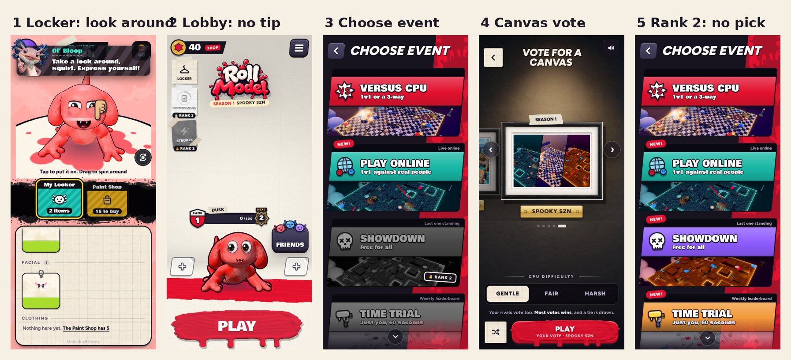
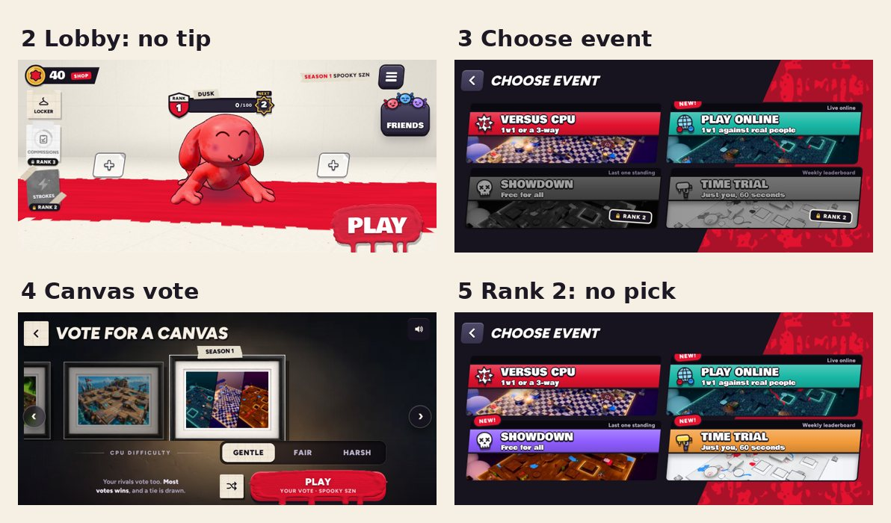

# v358: free once the locker's done

After the locker lesson (the fangs on, "Take a look around, squirt"), nothing tells you what to play next:

- **No "Time for a real match. Tap Play"** in the lobby, and the lobby is no longer dimmed around the Play button.
- **No "Play the CPU: tap Versus CPU" or "Tap 1 v 1"** on Choose event. Pick whatever's open.
- **No "pick a painting, then Play"** on the canvas vote. The page explains the vote itself ("Your rivals vote too. Most votes
  wins").
- **The full lobby from then on.** Until now it stayed the simple one (no Commissions plate, no CPU difficulty on the canvas
  page) until your second match was over.
- **No "New game modes!" card at rank 2**, and no "Try this one!" on the Showdown card. Time trial and Showdown still show
  NEW! on Choose event.

What stays:

- **The match you play next is still the second lesson match**, whatever you pick (1 v 1 or 3-way): its sun, shade and
  missile tips, on Sludge Sewer. If you go online instead, those tips don't run (they slow the game down), and the lesson
  waits for your next match against the CPU. The same goes for the third match's help with the orb.
- **The Strokes lesson at rank 2 and the Commissions welcome at rank 3.** They're about those pages, not about which mode to
  play.

The dashboard's tutorial funnel calls the step after the locker "Locker done, free to play" (it was "Canvas vote lesson").

## Tested

A probe went from the locker lesson on, upright and sideways (18 checks each, all passed):

- The fangs on moves the lesson on, and "Take a look around" shows in the locker.
- Back in the lobby there's no tip and nothing dimmed, then or 5 seconds later. The lobby is the full one.
- Choose event, the Versus CPU choice and the canvas vote have no tip. The canvas page shows the CPU difficulty.
- The match it picked (a 3-way, which the old tips never allowed) was the second lesson match: its tips running, on Sludge
  Sewer. When it ended, the onboarding was done.
- Online (a stand-in for an online match as it begins and ends): no lesson tips in the next match, in the second-match
  phase or in the third match, and the second-match phase waits for an offline match.
- A save at rank 2 that was waiting on the modes card and the Showdown pick gets neither (both marked done), and Showdown
  still shows as new. The Strokes lesson ends with nothing queued.
- No page errors.

Also checked: in the phase after the locker, a 1 v 1 and a 3-way both land the vote on Sludge Sewer. The earlier tests (the
v352, v351, v355 and v354 checks, and the dashboard's end-to-end and live tests) pass on this build.
