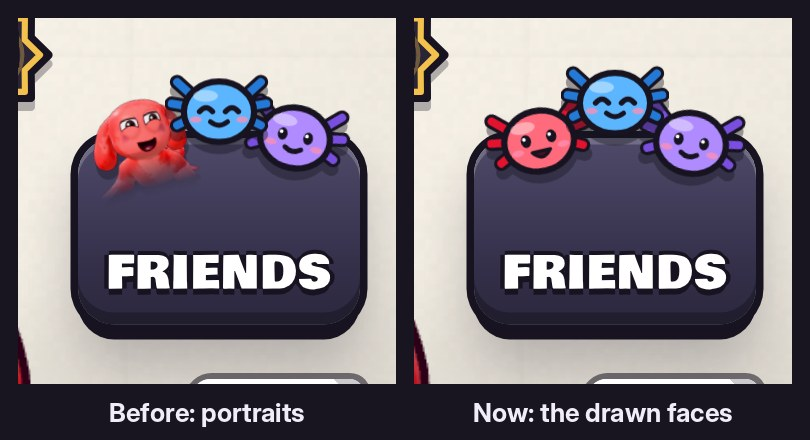

# v334: the Friends button keeps its drawn faces

- The lobby's Friends button shows its three drawn axolotl faces again: the red one smiling, the blue one with its eyes closed, the purple one with a little smile.
- v331 had put portraits there. Only this button goes back. Everywhere else keeps the portraits, including the Friends page, the name tag, the locker tab, Match found and the results.

## Tested
In the preview build, upright and sideways:
- The button holds exactly the three drawn faces, and no portrait replaces them later.
- The v331 portrait checks pass (41/43). The two that differ are the ones that expected portraits on this button, upright and sideways.
