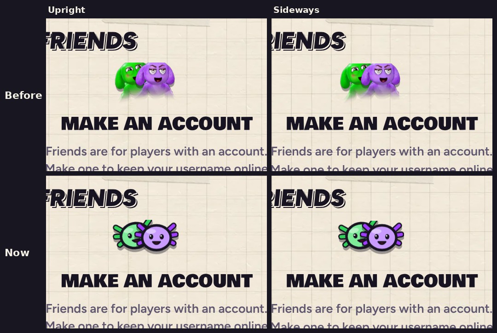

# v341: the two drawn faces on the Friends and account messages

- **The pair of faces over the Friends page's and the account form's messages are the two drawn axolotl faces again,** green and purple. Since v331 they had been portraits.
- **The same pair is on each of these messages:**
  - Make an account, Pick your username, and the signed-out ones.
  - Can't connect.
  - No friends yet.
  - The Online sheet's "on the way", "Can't connect" and "Update the game" messages.
- **Every other portrait stays:** your name tag, your friends' rows, Match found and the results.

## Tested
In the preview build, on a 390px-wide phone and sideways: the Friends page with no account (Make an account) shows the two drawn faces, green and purple, where the portraits were.
