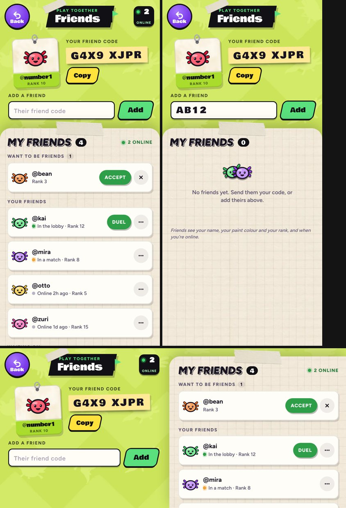

# v326: Friends as a full-screen page

The Friends pop-up, a notebook card over the blurred lobby, is now a page of its own. It borrows from the Strokes page and the locker.

## The page
- **The wall** is the Strokes page's lime wall, with its purple **Back** button at the top left and the taped black banner, "Play together / Friends", at the top.
- **The online badge,** at the top right, counts the friends who are online now. It hides when none are.
- **Your tag** is a hang tag like a stroke card. It shows your axolotl's face in your paint, with your name and rank on the lime strip.
- **Your friend code** is on the yellow strip beside your tag, with **Copy** and, in the app, **Share**. "Your code is copied" now shows right under it.
- **Add a friend:** the box for their code, with a green **Add**. Its messages ("Request sent", "No player has that code") show under the box.
- **The sheet** is the locker's graph paper, taped at the top. It has "My friends" in the locker's heading style, how many friends you have, and how many are online. It scrolls on its own and holds, in order:
  - duel invites;
  - friend requests to accept or decline;
  - your friends, as paper tiles with Duel and the "…" menu (Remove, Block);
  - the requests you're waiting on;
  - the blocked list;
  - the small print.
- **No friends yet:** two axolotls and "No friends yet. Send them your code, or add theirs above."
- **The other states** sit on the sheet, with your tag on the wall: make an account or log in, pick a username, getting your friend code, can't connect, and online play not switched on yet.
- **Sideways,** the wall runs down the left (banner, tag, code, add) and the sheet down the right.
- **On a small phone** (under 360px wide), the tag and code shrink a little so they still sit side by side.

Nothing about how friends work has changed: requests, duels, removing, blocking, polling, and keeping what you're typing when the list refreshes all behave as before. The sheet now also keeps its scroll position when the list refreshes. The lobby still holds still behind the page, so nothing renders underneath.

## Tested
In the preview build, on 390px, 430px and 320px-wide phones and sideways, 44 checks, all passing. Stand-in friends were used, since the test browser can't reach the friends server. In each state (a full list, none yet, account needed, getting your code):
- nothing runs off the sides;
- the online badge counts right;
- Copy's message appears under the code;
- typing in the add box survives a refresh;
- the sheet keeps its scroll through a refresh;
- a friend's "…" menu opens;
- Back closes the page;
- no page errors.
