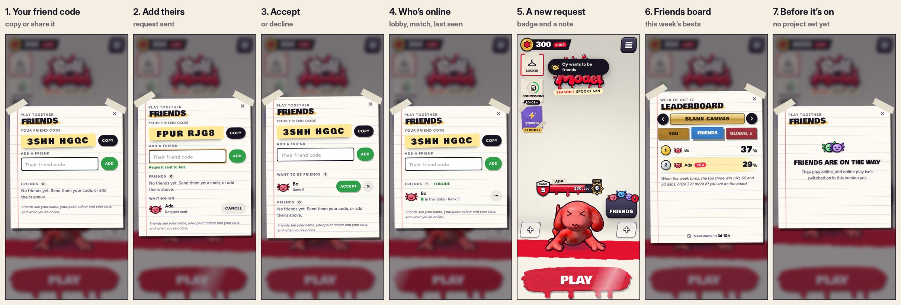

# v305: Friends

Friends live in the game's Supabase project. Setup steps are in `supabase/README.md`: switch on anonymous sign-ins, run
one SQL file, and send me the project URL and publishable key. Until then the game builds with online play off, and the
Friends screen says friends are on the way (picture 7).

## What a player gets

- **A friend code.** Eight characters, shown as two groups of four (`3SHH HGQC`), with no 0/O or 1/I/L to mix up. Copy
  puts it on the clipboard; in the iOS app, Share opens the share sheet (Messages, AirDrop and so on).
- **Adding a friend.** Type their code; spaces and lower case don't matter.
  - They get a request.
  - If they'd already added you, you're friends at once.
  - A wrong code says so. After 30 tries in an hour it asks you to wait, so codes can't be guessed.
- **Requests.** Accept, or decline with the cross. What you've sent waits under "Waiting on", with Cancel.
- **Who's online.** Each friend shows their face in their paint colour, their rank, and one of:
  - "In the lobby" (green);
  - "In a match" (amber);
  - when they were last on ("Online 3h ago").

  The game checks in every 6 seconds while the Friends screen is open, every 20 seconds in the lobby, and every minute
  in a match. Closing the app marks you offline.
- **Remove or block.** The "..." on a friend's row offers Remove friend and Block, each with a confirm step. A block
  isn't announced: their requests just never arrive. Blocked players are listed at the bottom, with Unblock.
- **A new request while you're in the lobby:** a red count on the Friends button, and a note at the top for 3 seconds.
- **The Friends board.** The Time trial leaderboard's Friends tab now shows this week's bests of you and your friends on
  each canvas.
  - Your runs go up as you finish them. Runs finished offline are kept and sent later.
  - When the week turns, the top three of a board with three or more people on it win 100, 60 and 30 dabs.
  - The Global tab stays locked until online play.
- **The lobby holds still** behind the Friends screen, as it does under Commissions, so the screen scrolls smoothly.

## How it works

- **No library.** The page talks to Supabase's REST API with plain requests, so nothing new is bundled into the app.
- **Sign-in.** The first time, an anonymous account is made (no email). Its refresh token is kept with the save.
  - An expired session refreshes itself.
  - A reopened app signs back into the same account.
  - If the saved token is dead, a fresh account is made, and the old one's id is kept in the save.
- **Database access.** Everything goes through the database's `rm_*` functions. The tables themselves are closed to the
  app, and the functions only hand out what that player may see: their own profile, their friends, and the people with a
  request to or from them. Profiles can't be searched.
- **Friends see:** your name, your paint colour and eye style, your rank, and when you're online. Nothing else.

## Tested

- **The SQL**, on a local Postgres with a stand-in for Supabase's auth (`supabase/tests`): 8 tests, all passing.
  - The tables are closed; only the functions answer, and only to a signed-in player.
  - Profiles: made once, the code kept, names cleaned (control characters out, at most 16 characters).
  - Requests both ways, accept, decline, cancel, remove.
  - Blocks: the friendship goes, and their requests never arrive.
  - Invites: friends only, one open at a time, they run out after 2 minutes.
  - The rate limit on wrong codes.
  - The Time trial best of the week, and a board of you and your friends only.
- **The game**, with two browsers against a local stand-in for Supabase's sign-in and API (pictures 1 to 6):
  - Ada's code typed in lower case by Bo: "Request sent to Ada."
  - Ada accepts, and each sees the other "In the lobby".
  - A third player's request while Ada is in the lobby: the red 1 and the note.
  - Bo's 37% and Ada's 29% on the Friends board.
  - Remove, with its confirm step.
  - The off and can't-connect screens.
- **The edge cases:**
  - An expired session refreshes itself.
  - A reopened app keeps the same account and code.
  - A run finished offline is queued and goes up later.
  - Last week's board pays 2nd place 60 dabs, and only once.
  - A dead sign-in token gets a fresh account.

## Still to come

- **Invites to a private duel.** The database side is done and tested (`rm_invite`, `rm_answer_invite`). The buttons
  come with online duels, which is the next piece of work: the game server makes a private room, the invite carries its
  code, and accepting joins it.
- **One identity on the game server.** It should accept the Supabase account's token, so ratings and friends match up.
- **Sign in with Apple.** It keeps an account if the app is deleted. Today a deleted app means a new anonymous account,
  and new friend codes all round.
