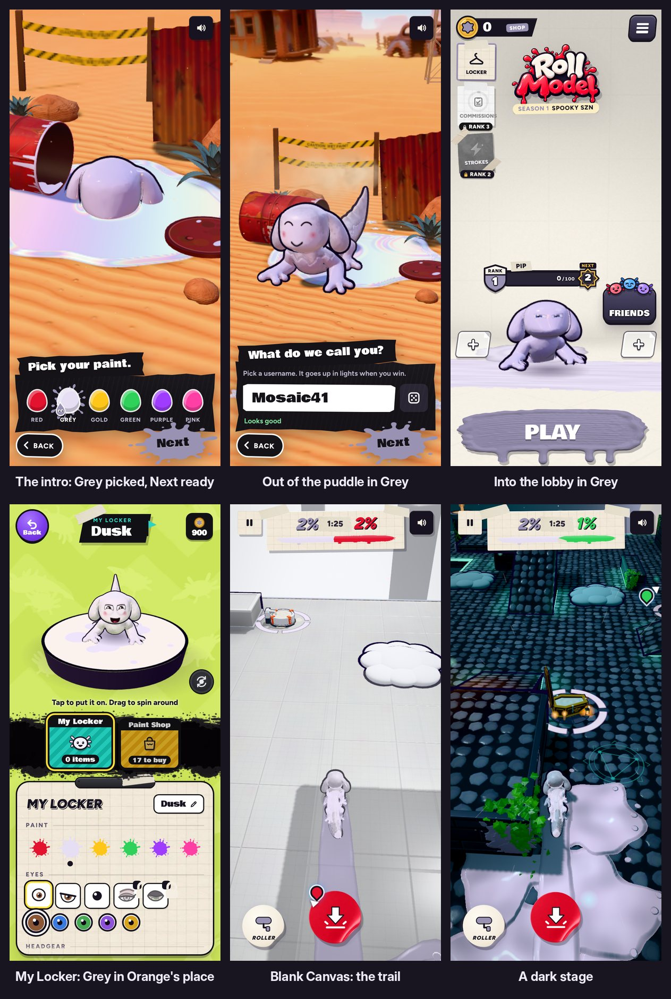

# v329: Grey, the intro's paint, in Orange's place

The pearly light grey your character comes up out of the barrel's puddle in is now a real paint you can play with. It takes Orange's place, so the six paints are Red, Grey, Gold, Green, Purple and Pink.

## The intro
- **"Pick your paint." opens with Grey already picked,** and Next is ready straight away. Tap Next and you keep the colour you came up in.
- **Picking another paint works as before.** The puddle and you change to it.
- **Coming back to Grey** brings the pearly puddle back.
- **You climb out in Grey,** and it stays yours in the lobby.

## Grey everywhere else
- **On you:** your character is the intro's light grey all over, ears and belly included. Before, a pale paint like this would have come out purple.
- **On the canvas:** your paint goes down a shade deeper than you, so your trail stands out on the light floors (Blank Canvas, Palette Island) as well as the dark ones.
- **In the menus:**
  - The swatches and dabs show the true light grey.
  - Buttons and labels in your colour use a deeper grey, so text on them stays readable.
- **Painting titles** use Pearl, Silver and Ash.

## Orange
- **A save that had Orange** comes back as Grey.
- **The CPU rivals can still wear Orange.** They never wear Grey.
- **Friends and online rivals:**
  - A friend whose last pick was Orange still shows in Orange.
  - An online rival on an older build who picked Orange shows in it.
  - An online rival who picked Grey shows in Grey.

## Tested
In the preview build, on a 390px-wide phone and sideways, 65 checks, all passing. The v327 locker checks (48) and the v328 tap checks (13) also still pass.
- **An Orange save** comes back Grey, on you and saved.
- **The locker** shows Grey picked. Red and back to Grey work.
- **The rivals:** in 400 rolls the CPUs never wore Grey, and Orange still came up. A rival in your colour is never swapped to Grey.
- **Faces:** a friend's old Orange face still draws, and so does a Grey friend's.
- **Matches** on Blank Canvas, Palette Island, Sludge Sewer, Fishing Raft and a Spooky SZN stage: you in Grey, no rival in Grey, your paint on the floor.
- **The intro, played through twice:**
  - Grey picked on the card, Next ready, the pearly puddle kept. Next went on to the lobby in Grey.
  - Red, then back to Grey (the pearl came back), then Red. It went on to the lobby in Red.
- **The bright paints** are unchanged: the grey handling only switches on for a paint that pale.
- **No page errors.**
