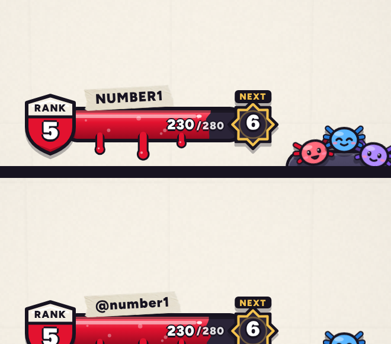

# v311: an online account shows as a handle (@number1)

**The rule:** a player signed in with an account shows as **@** and their username in small letters. Without an account, the name shows as before.

**Where your handle shows**, wherever the game shows your name:

- the tape over the power bar;
- your stats and the locker;
- the versus card;
- the tally and the results;
- the winner screen;
- Showdown's lists and banners.

**Other players:** anyone with an account shows by their handle too:

- the rival in an online match;
- everyone in the Friends and online lists (friends, requests, the Friends board, the room, "You vs ...").

CPU rivals keep their plain names, so an @ always means a real person.

**Capitals:** where names are set in capitals (the tape, the versus card, the tally, the winner screen), a handle keeps its small letters. In the tally that reads **@number1** against **GLOP**.

**Settings and sign-in:**

- Settings says "Signed in as @number1".
- The welcome after making an account or logging in uses the handle.
- Logging out puts the plain name back at once.

**Tested** (signed in as the game sees it, then signed out):

| Where | Shows |
|---|---|
| The tape | @number1, in small letters |
| Stats | @number1 |
| The tally | @number1 against GLOP (a CPU) |
| A friend row | @sploosh_22 |
| After signing out | Number1, in capitals as before |
