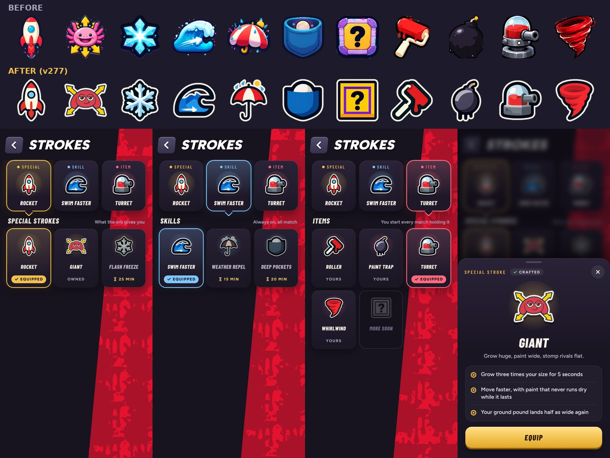

# Flat stroke pictures (v277)

Every picture on the Strokes page was made again with Ludo.ai in one much simpler, flatter style. Built in `tools/v277_flat.py`;
the pictures are `tools/assets/*_flat_256.webp`.

## The style

- Solid flat colours and a thick dark outline, with no gloss, sparkles, splatter or soft shading.
- A thin cream sticker edge around each one, so the dark outlines still read on the page's dark tiles.
- The soft blurred shadows under the pictures on the Strokes page are now a hard, flat drop to match.

## The Giant

The old Giant was a generic happy axolotl with gills, which isn't her any more. The new one was drawn by Ludo from the character
in the lobby: the round red dome head, the long floppy ears hanging down, the big heavy-lidded eyes and the smirk, with four yellow
arrows pushing out to show her growing.

## What changed

The Rocket, Giant, Flash Freeze, Swim faster, Weather Repel, Deep Pockets, the More soon crate, and the start items (Roller, Paint
Trap, Turret, Whirlwind). The orb button in a match shows the same pictures. The in-match item buttons keep their simple line icons.
