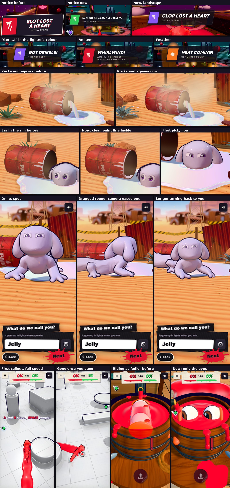

# Notices, the intro's desert and drum, turning it round, the first callout, hiding (v285)

## Mid-match notices

Built in `tools/v285_feed.py`. Every mid-match notice uses it: a knock-out, "lost a heart", "Got ...!", an item's name, the weather.

- Smaller: about a quarter less across and in height, the headline 19 to 27 px (it scales with the screen).
- See-through: the panel is 84% dark, so the play behind it shows.
- Shorter: 1.7 s (was 2.1), a long one 2.8 s (was 3.4), a quick one like "lost a heart" 1.3 s (was 1.7).
- Cleaner: a slim slanted strip with a hairline edge, no cream rim, no wallpaper of paint marks, no heavy shadow. The knocked-out
  fighter's colour is a slanted block at its start with a small mark in it (the event's colour for weather and items). Italic
  headline, a small spaced-out line under it.
- One soft sheen crosses it as it lands. It slides in from the left, sits, and lifts away up.
- No Ludo art in it: a plain strip read cleaner than any of the painted takes.

## The intro's rocks and agaves

Built in `tools/v285_intro_set.py`.

- Rocks: weathered sandstone boulders, rounded and lumpy (320 to 1,280 triangles each, about 7k in all, was 80 each), with ledges
  worn along their beds and flat where they sit in the sand. A sandstone texture made on the spot: level red, orange and pale
  bands, thin dark seams, mottling, grain, pits and dark streaks of desert varnish, with a normal map from the same heights so the
  grain and seams catch the light. Darker low down and in hollows, sand-dusted on top.
- Agaves: 22 thick, channelled leaves to a plant in a golden-angle spiral (was 13 flat strips): short and upright in the middle,
  long and arching outside. Each leaf has a texture: pale at the base, blue-green going darker to the tip, toothed margins, a
  lighter midrib, faint bud prints, a dusty bloom and a dark spine at the tip. They still sway in the wind. About 2.8k triangles
  for the four.
- Same places and sizes, so the shadows and its way round them are unchanged.

## The drum

Built in `tools/v285_intro_drum.py`.

- Its ear no longer swings into the drum's rim: where its head comes up out of the puddle is 14 cm further out from the mouth,
  along the way the paint ran (the ripples, the ring and the camera's close shot moved with it), and its glance away from the drum is a little smaller.
- A line of the pearly paint is left inside the drum, along the side it lies on, from the closed end to the mouth, wider toward
  the mouth with a wavering edge, darker deep inside. It reads as where the paint came from.

## Turning it round in the intro

Built in `tools/v285_intro_turn.py`.

- Once it's out and standing on its spot (naming it, "All set?", and the picks again after "Not yet"), drag across the scene,
  anywhere but the cards, to turn it round, as in the locker. A flick sends it gliding on. Its body, tail and ears curl with the
  turn, as they do in the locker.
- While it's being turned the camera eases back, slowly (up to 42% further out, about two thirds of that after two seconds).
- Let go: it glides to a stop, waits a beat (0.45 s), blinks and turns itself back round to face you, the short way and at its
  own pace. As it comes round the camera eases back in.
- Tapping Let's roll straightens it up at once.

## The first callout at full speed

Built in `tools/v285_first_steer.py`.

- "DRAG to steer, TAP to jump!" no longer slows the game (no slow motion, no slowed music, no gold frame).
- It fades out the moment you start steering. The step still ends as before (a steer and a jump, or a short crawl).
- The later callouts (the fling, the dodges) still slow it down, as before.

## Hiding in a basin

__HIDE__
