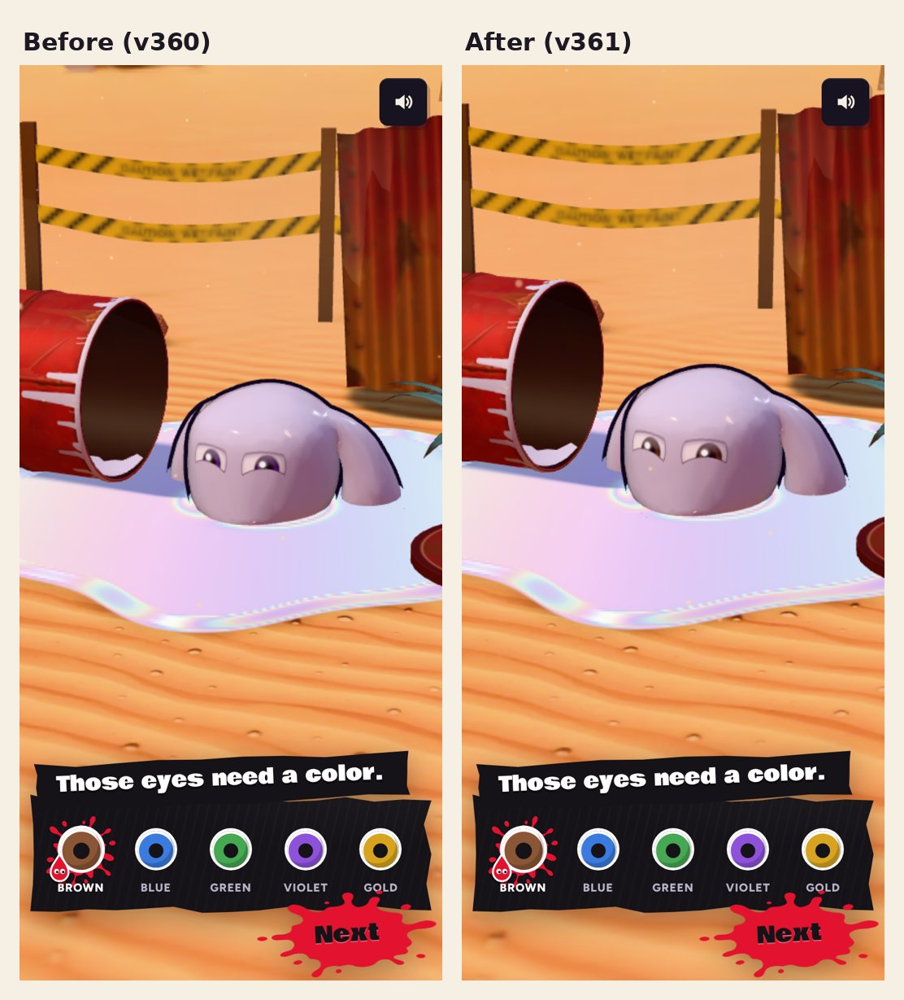

# v361: the first launch's eyes match the picked color

On the first launch the eye color card had **Brown** picked (the game's default), but the character's eyes came up **violet**:
the intro made the character without an eye color, so it showed the model's own default.

Now the character wears the picked look as soon as it's made: brown eyes (and Round style) from the moment they rise out
of the puddle. If you just tap Next, the eyes you keep are the ones you saw. Tapping another color changes them as before.

## Tested

A probe played the first launch up to the eye color card on the build before and this one, reading the character's actual
eye color:

- Before: Brown picked, eyes violet (the bug, reproduced).
- After (6 checks, all passed): Brown picked and the eyes brown, both on the card and while the eyes rise before it; the
  style Round as picked; tapping Blue turns them blue; no page errors.
