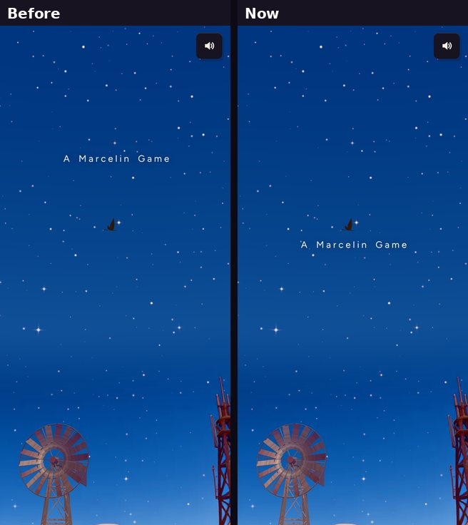

# Intro title nearer the middle (v288)

Built in `tools/v288_intro_title.py` (a patch over the intro, `tools/v257_intro.js`).

- "A Marcelin Game" sat about a quarter of the way down the screen. Its middle is now at 44% of the screen's height, just above
  centre, on any screen size (never closer to the top than the notch allows).
- Same line, size, timing and animation.
