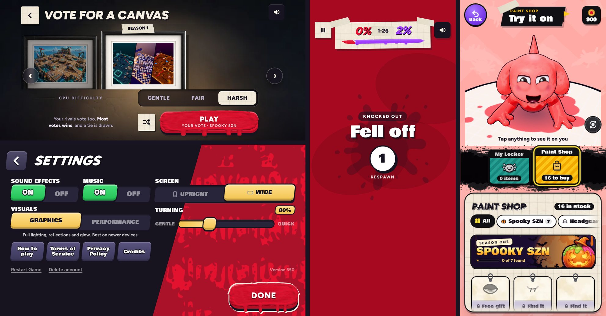

# v350: launch polish from a sweep of every screen

Every screen was opened on four devices, upright and sideways: an iPhone SE, an iPhone 15, an iPhone 15 Pro Max and an iPad. That's eight runs, each with that device's notch and home bar.
- **What was fine everywhere:**
  - No page errors.
  - Nothing scrolls sideways.
  - No button is off screen.
  - The iPad layouts hold up, upright and sideways.
- **What was fixed:**
  - **The canvas vote's arrows** sat under the notch and the Dynamic Island when an iPhone was held sideways. They now stay clear of it. Upright they're where they were.
  - **The knocked-out screen said the same thing twice** ("FELL OFF" over "Fell off", "BAKED" over "Baked!", "DRIED UP" over "Dried up!"). With nobody to blame, the small line now says "Knocked out" and the big line says how. Splatted by a rival is unchanged.
  - **Small buttons are easier to hit,** with no change to how they look. Each now takes taps a little way around it:
    - Restart Game and Delete account at the foot of Settings;
    - the pencil by your name on the Stats card;
    - your name in My Locker;
    - the Paint Shop's filter chips.
  - **Pictures can't be lifted and dragged with a long press,** the way a web page's can.
  - **The iPhone app has no test unlocks** ("Unlock everything", "Unlock all items" and their code) unless it was run from Xcode.
    - TestFlight builds go without them too, because App Review installs look just like TestFlight ones, and a reviewer mustn't find a secret code.
    - The browser preview keeps them.
- **The app bundle is about 1 MB smaller:** the boss demo's pack and a network test script no longer go into it (the game never loads either).

## Tested
In the preview build, 24 checks, all pass:
- **Canvas arrows:** sideways on an iPhone 15 they sit 63 px in, clear of the 59 px notch. Upright they're 10 px in, as before.
- **Knocked out:** fell off, baked, dried up and caught outside each say "Knocked out" over the reason. Splatted by a rival says "Splatted by" over the name.
- **Tap areas:**
  - The Stats pencil, your name in My Locker and the shop's chips each take taps 5 px outside them.
  - The name beside the pencil still takes its own taps, and a gap between two chips goes to the nearer one.
  - On an iPhone SE, upright and sideways, Restart Game and Delete account take taps around them, and the four buttons above them keep their bottom edge.
- **Delete account** goes from Settings on signing out, and Settings fits itself to the screen again.
- **Test unlocks:** shown in the browser, hidden in an App Store build, shown in an Xcode build.
- **No page errors** in any run.
