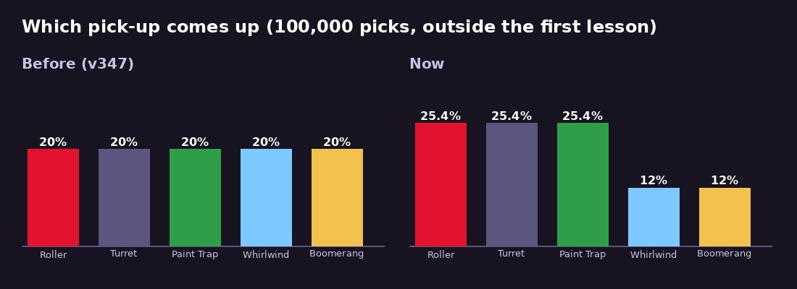

# v348: fewer Whirlwinds and Boomerangs

- **The Whirlwind and the Boomerang each come up 12% of the time,** 8 points under the 20% they had.
- **The Roller, the Turret and the Paint Trap share what that frees up,** about 25% each.
- **How:**
  - Pick-ups still come in shuffled turns (v347). The Roller, the Turret and the Paint Trap are in every turn.
  - The Whirlwind and the Boomerang are each in a turn a little under half the time (47%).
  - A turn then holds 3 + 2 × 0.47 kinds on average, so each of the two makes up 0.47 / 3.95 = 12% of what comes up.
- **The turns now run on from one match to the next** instead of starting over each match. Starting over would favour whatever comes first in a turn, and the shares wouldn't hold.
- **Unchanged:**
  - The same kind never comes twice in a row.
  - A pick-up nobody takes still swaps for a different kind.
  - The first lesson keeps its Rollers and Turrets.

## Tested
In the preview build. 8 checks, all pass:
- **100,000 picks:**
  - Whirlwind 12.00% and Boomerang 11.95%.
  - Roller, Turret and Paint Trap 25.35% each.
  - Never the same kind twice in a row.
- **Onboarding match 2:** all five come up, with the two at 12%.
- **The swap** never brings the same kind (5,000 tries).
- **The first lesson** is unchanged.
- **A new match carries the turn on.**
- **A whole 90-second 3-way** played with no page errors. It put out Paint Trap, Roller, Boomerang.
