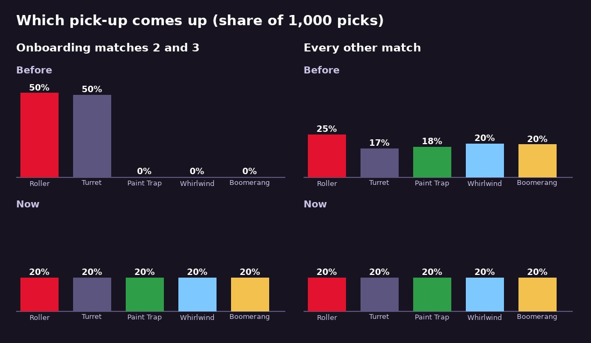

# v347: every pick-up comes up, from your second match on

## Why it was mostly Rollers and Turrets
There are five pick-ups: Roller, Turret, Paint Trap, Whirlwind and Boomerang. Your rank never locked which ones could appear, but three things made a new player see mostly two:
- **Onboarding matches 2 and 3 only ever put out Rollers and Turrets,** just like the first lesson.
- **In other matches it was a weighted draw.** The Roller came up most (25%, against 17 to 20% for the others), and the same kind could come up twice in a row.
- **The item you start a match holding is the Roller until you craft others** on the Strokes page (the Turret opens at rank 3, the Paint Trap at 5, the Whirlwind at 7 and the Boomerang at 9).

## Now
- **Outside the first lesson, pick-ups come in turns.** Each turn is all five in a shuffled order, so every kind comes up before any comes again, and never the same kind twice in a row. Each match starts a new turn.
- **This covers onboarding matches 2 and 3,** so a new player sees all five from their second match.
- **A pick-up nobody takes still swaps for a different kind:** the next one in the turn that isn't the same kind.
- **Unchanged:**
  - The first lesson keeps its Rollers (and Turrets once the flower's found).
  - Online matches still have no pick-ups.
  - The item you start holding is still the one equipped on the Strokes page.

## Tested
In the preview build. 1,000 picks each, before and now:
- **Onboarding matches 2 and 3:** before, 50% Roller and 50% Turret. Now, 20% for each kind, every turn of five has all five, and none comes twice in a row.
- **Other matches:** before, 25% Roller, 17% Turret, 18% Paint Trap, 20% Whirlwind, 20% Boomerang, with 122 picks repeating the kind before. Now, 20% each and no repeats.
- **The first lesson:** only Rollers before the flower, then Rollers and Turrets.
- **A pick-up nobody takes** is never swapped for the same kind (1,000 tries).

Whole matches, recording every pick-up that appeared:
- **Onboarding match 2 (75 s):**
  - Before: Turret, Roller, Turret.
  - Now: Turret, Paint Trap, Boomerang, Whirlwind.
- **A 3-way at rank 2 (90 s):** Paint Trap, Boomerang, Turret, Whirlwind.
- **A duel at rank 2 (90 s):** Roller, Turret, Paint Trap.

No page errors.
