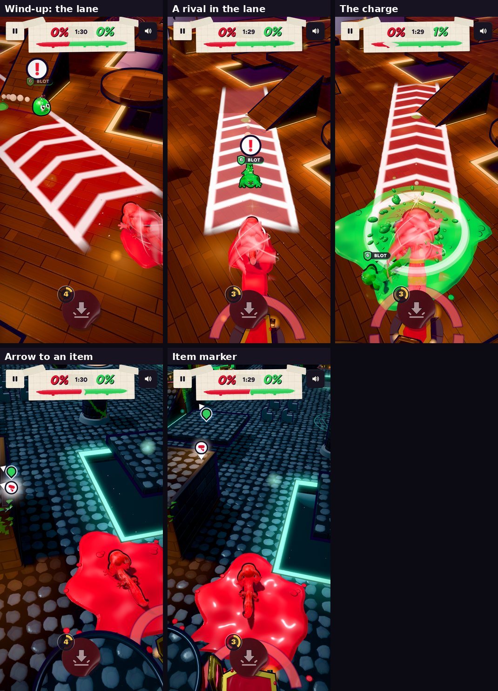

# Whirlwind notice and pick-ups by need (v285)

Built in `tools/v285_items.py`, with two Ludo.ai sounds in `game/sfx/` (`w_wind.mp3`, `w_ting.mp3`).

## The Whirlwind gives a second more notice

- It winds up for 1.3 s (was 0.3 s).
- A lane on the ground shows where it will charge: as far as the charge runs, stopping short of a drop or a wall. White rails mark
  its edges and chevrons run the way it will go, filling up as it winds. It's in the whirler's colour.
- The whirler aims it (you steer; a CPU turns toward its nearest rival) until 0.45 s before the charge. Then it locks: the lane
  flashes, a gold star glints on the whirler with a bright "ting", and it can't turn any more.
- That glint is the cue. Step out of the lane, or roll through as it arrives (a roll can't be hit).
- In the charge it steers less (0.3 of normal, was 0.5) and leans toward a rival less (a narrower cone, half the turn), so a dodge
  in time works.
- New sounds: a rising swirl for the wind-up and the "ting" for the lock.
- CPUs read it too: lined up in the lane at the glint they step out (as often as their level dodges a pound), their routes avoid a
  winding lane, they stop going at a rival who is whirling, and in the charge they roll through it at the last moment.

## Pick-ups by need

Before: one item could be out at a time in a 1v1 (two in bigger matches), 9 to 13 s apart, on spots chosen to be "worth the
trip" (up high, out on pads), and CPUs only fetched ones close by. One would land where nobody went, sit there all match and
block every other spawn.

Now who has one (held, in a pocket, or in use) and who doesn't decides when the next comes and where:

- **When**: one comes for whoever has waited longest with nothing. The wait is 6 s, shorter when nobody has one (-1.5 s) or rivals
  are holding theirs (-1 s each, up to -2 s), and longer for the side that's ahead (+2.5 s; behind: -1.5 s), between 3 and 10 s.
  The leader still gets them, just later.
- **How many**: never more out than there are empty hands, so they don't pile up.
- **Where**: a short run away (about 8 steps), ahead of where they're facing when it can be, nearer them than any rival, on their
  level, inside the Showdown line, clear of basins and boiling water. Anyone can still race them for it.
- **Seeing it coming**: 1.2 s before it appears, a beam of light and a closing ring mark the spot (with a ping if it's near you).
  While you've got nothing, an arrow with the item's icon points you to the nearest one when it's off screen or far.
- **No dead items**: one nobody takes in 25 s, or that the Showdown line closes over, pops, and the next goes somewhere useful.
- **CPUs** go and get one that came for them, and the longer they've waited the further they'll go for any other.

The first lesson keeps its own scripted items.

## Measured

CPU-only matches stepped faster than real time (the player handed to the game's CPU brain), medium CPUs, 5 matches per mode.

__TABLE__
