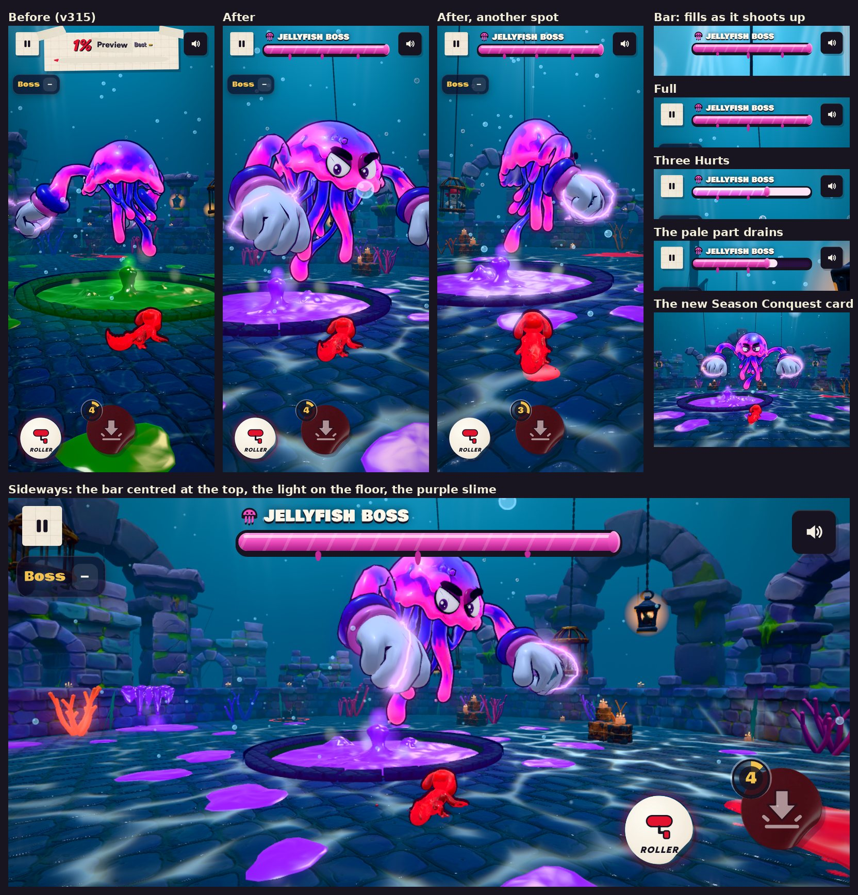

# v316: the Sunken Keep's light, purple slime, the Jellyfish Boss's health and sounds

## 1. Brighter in the shadows

- The light from below is a lighter blue and a little stronger.
- The picture's contrast is eased (1.1 to 1.05), its blacks are lifted a touch toward blue, and the vignette is lighter (0.36 to 0.3).
- The lit parts stay much as they were.

Measured on the same view upright, the floor's middle brightness went from 0.149 to 0.185 and its darkest tenth from 0.091 to 0.107.

## 2. Underwater light on the floor

The faint caustics are now the light you see on a sea floor:

- A web of bright, wavy lines, with brighter knots where they meet.
- It slides over itself two ways at once, so the light gathers into little blotches that wander and glisten.
- Broad patches of it are brighter and drift slowly, like light coming down in beams.
- Its edges split a little into colour.
- It covers the floor's ring, and fades a little way up the wall and into the distance.

The web is drawn once, the first time the keep is built, not at launch. On lower graphics settings it's the same without the colour split.

## 3. Purple slime

Everything that was green slime is now a vivid violet, a little brighter than the green was, so it stands apart from the boss's pink:

- The pool, the spout, the sheets over the wall top, the drips and the puddles.
- The glow and the light the slime throws.
- The pit under the pool.
- The drops when something falls in.
- The boss's own slime: the line where it comes out of the pool, and the slime it throws off.

The sewer's slime stays green: the drops' colour now comes from each stage.

## 4. The Jellyfish Boss's health

A bar of the boss's pink paint across the top of the screen, under its name, **Jellyfish Boss**, with a little jellyfish beside it.

- **The look:** glossy, slowly flowing paint in a dark tube, with a rounded bulge of paint at its end and drips hanging under it.
- **Where:** in the boss demo it takes the place of the coverage card ("Preview", its percent and Best). Upright it sits between the pause and sound buttons; sideways it's wider, in the middle of the top.
- **Entrance:** it comes in with the boss. As the boss shoots up out of the pool, the bar drops in and fills from empty to full. When the entrance plays again, or the boss comes back after a defeat, it goes and comes back the same way.
- **Hurt:** takes 12% off. The bar jolts, flashes and throws a few drops of paint. The lost part shows pale for a moment, then drains away.
- **Defeat:** at zero, the boss is defeated by itself. Defeat drains whatever is left.

## 5. Sounds, made with Ludo

No music on the keep: its water, its slime and the boss are what you hear. The stage's song isn't fetched, and the game's stand-in synth tune doesn't play either.

The sounds are 28 files in `sfx/` (about 0.5 MB in all). They're fetched when the demo opens and let go when you leave it, so a normal match never loads them.

| When | Sound |
|---|---|
| The keep, all the time | A calm underwater bed (deep muffled water, a soft distant rumble), looping. Lower while paused |
| Near the pool | The slime bubbling, louder the closer you are |
| A drip lands near you | A gloopy plop |
| The skeleton shakes its cage | The cage rattles |
| You fall in the slime | A gloopy splash, and the skeleton cackles |
| Entrance | The pool churns, the gloves burst out, slam on the curb, it hauls itself up, one huge whoomp shoots it up, fist bump with sparks, a roar |
| Swimming | A soft whoomp on each beat of its bell, quieter further off |
| Punch, Slam, Zap | A wind-up, then the fist landing, both fists slamming, or the zap's charge and discharge |
| Sweep | A heavy swoosh |
| Hurt | A squelch and a groan |
| Stunned | A dizzy warble |
| Taunt | A bubbly mocking laugh |
| Defeat | It deflates with a gurgle and sinks with a last gloop |

- The sounds heard most have two takes, played in turn.
- Each hit is placed where it lands: panned, and quieter further off.
- If a sound hasn't loaded yet, the game's old sound plays in its place.
- Your own bump when a hit knocks you back is unchanged.

`tools/boss_sfx_build.py` remakes the files from the Ludo takes: it trims and levels each one and builds the two seamless loops.

## 6. A new Season Conquest card

Choose Event's card has a new picture: the keep as it is now, purple, with the boss over the pool and you in front.

## Also in this version

The intro's music fix: if you leave the app during the intro and come back, the hand-over to the menu song stays in time.

## Tested

**Upright and sideways, in the boss demo:**
- The bar stays hidden until the boss shoots up, then fills.
- It's full when play starts.
- Three Hurts take it to 64%, with the lost part pale and then draining.
- At zero the boss is defeated by itself.
- It hides as the boss comes back, then fills again.
- Leaving the demo hides it and brings the coverage card back.

**The look:** compared on the same views before and after, upright and sideways.

**Sound, the whole run:**
- **A normal match first:** its song plays, and none of the demo's sounds are fetched or played.
- **The boss demo:** the seven entrance sounds play in order and the bar shows. No song plays, even when paused, and the water and the pool loop.
- **Back to the menu:** the loops stop, the demo's sounds are let go, and the menu song comes back.
- No page errors anywhere.
