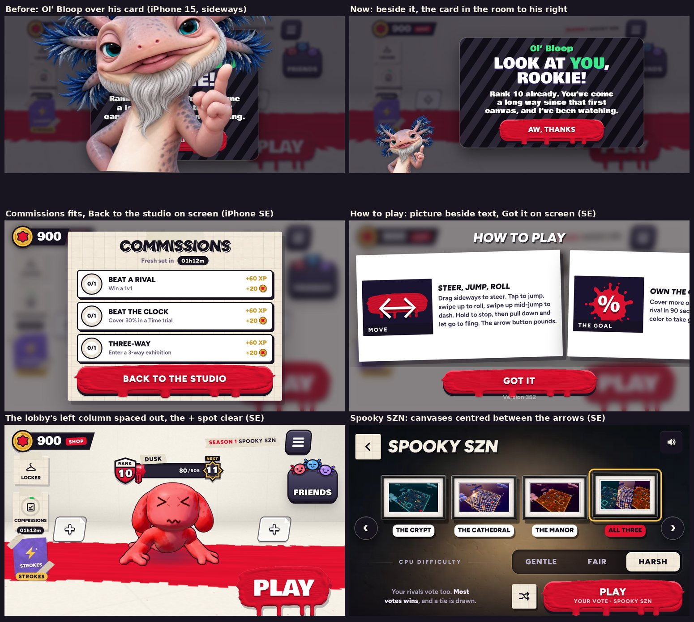

# v352: a quicker Whirlwind, and the game held sideways

- **The Whirlwind goes off sooner.**
  - Its wind-up is 1.0 s (it was 1.3 s).
  - Its lane still locks 0.45 s before the charge, so rivals get the same tell to dodge.
  - The Strokes page says 1 s, and its demo winds up for the same time as a match.
- **Ol' Bloop no longer covers his own cards held sideways.** This was the glitch on "Look at you, rookie!"; it also hit "Commissions are open!", "New game modes!" and the lesson's last card.
  - **The cause:** two things shared one class name. The online card's `.oncard` (v306) was also the class Ol' Bloop takes beside a card, so its width (up to 620 px sideways) went to him. His is `.atcard` now.
  - **Sideways now:** Ol' Bloop stands in the bottom-left corner, a little bigger, and the card is centred in the room to his right. The card is more compact, so the longest one fits on an iPhone SE.
  - **Upright:** no change. He still stands over the card.
- **The rest of the app held sideways.** This comes from a sweep of every screen sideways on an iPhone SE, 15, 15 Pro Max and an iPad.
  - **The lobby's left column** (Locker, Commissions, Strokes) is spaced out.
    - Commissions' countdown no longer runs into the Strokes card.
    - The "+" spot at your left keeps clear of the column. On an iPhone SE it overlapped Commissions.
  - **Commissions** fits the screen with Back to the studio on it. Before, the button was below the bottom edge on an iPhone SE and cut in half on an iPhone 15.
  - **Stats** also fits the screen.
  - **Terms of Service, Privacy Policy and Credits** keep their Back button on screen, with the text scrolling above it. Before, Back was off the bottom.
  - **How to play** puts each card's picture beside its text, so a card and Got it fit on the screen. Before, the cards ran off the bottom.
  - **The Time trial board** keeps "New week in" inside its card.
  - **The login form** sits in the middle of its card. It used to hug the left.
  - **The canvases are centred between the arrows**, both the picked canvas and the Spooky SZN four. The left arrow used to cover "The Crypt". On a small phone, "The Cathedral" still fits.
  - **The locker's line** ("Tap to put it on") clears its window's edge.
  - **"Commissions"** fits its card in the lobby, upright too. It ran a little past both sides.

## Tested
- **v352 checks** (`p352.py`): 25 of 25 pass.
  - **The cards:** all four lobby cards on an iPhone SE held sideways. Ol' Bloop is beside each one at his own size and covers none of its title, text or button, and each card fits the screen.
  - **Upright:** Ol' Bloop still stands over his card.
  - **The lobby:** the "+" spot clear of the left column; the countdown clear of the Strokes card; "Commissions" inside its card.
  - **Buttons on screen sideways:** Commissions, Stats, Terms and How to play.
  - **Inside its card:** the Time trial board's footer.
  - **Spooky SZN:** the canvases clear of both arrows and centred, with no name cut short.
  - **The Whirlwind in a real match:**
    - it charges 1.0 s after the tap;
    - its lane locks 0.55 s in;
    - the Strokes card says 1 s.
  - **No page errors.**
- **v351's native-feature checks** still pass on this build: 26 of 26 and 7 of 7.
- **Sweeps:** every screen swept again, sideways on an iPhone SE and an iPhone 15, and upright on an iPhone 15. The screenshots were reviewed by eye.
