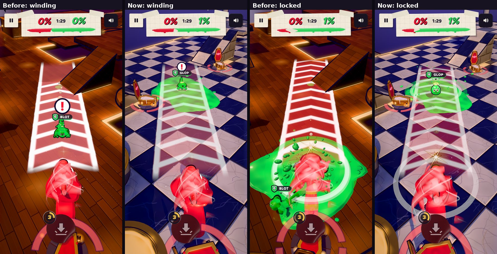

# v294: the Whirlwind's lane at half strength

- The lane a Whirlwind lays on the ground while it winds up is now drawn at half its opacity. That covers the strip, the side rails,
  the chevrons and the flash when it locks. It still shows where the charge will go and when it locks, but the stage reads through it
  and it no longer takes over the screen.
- The gold glint on the whirler at the lock and the "ting" are unchanged, so the cue to get out of the way is just as clear.
