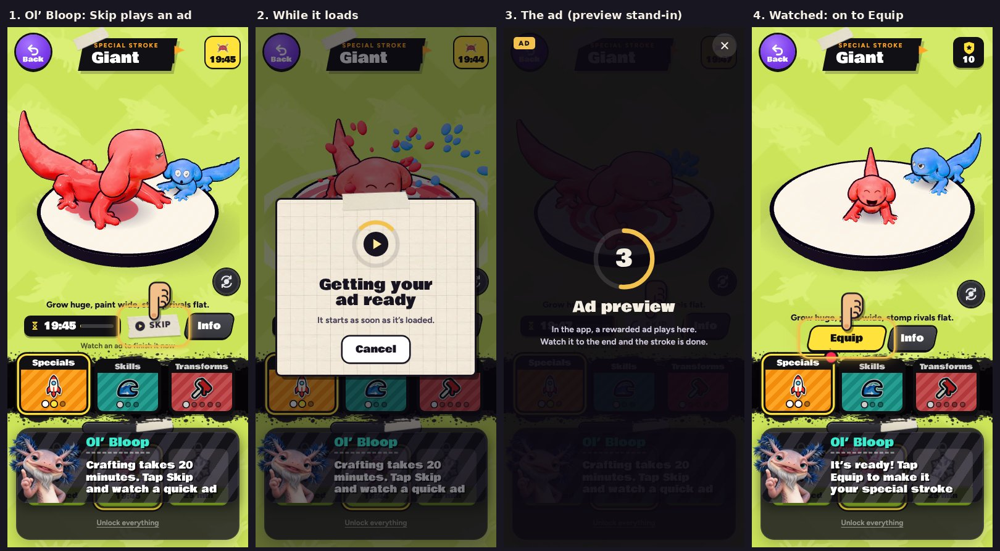

# v340: the lesson's Skip plays an ad too

- **In Ol' Bloop's Strokes lesson, Skip on the Giant's craft was free** ("this one's on me").
- **Now it plays the rewarded ad, like any other Skip:**
  - Skip has the play mark, with "Watch an ad to finish it now" under it.
  - While the ad loads, the "Getting your ad ready" card shows.
  - Once the ad's been watched, the Giant is done and Ol' Bloop moves on to Equip.
- **Ol' Bloop says so:** "Crafting takes 20 minutes. Tap Skip and watch a quick ad".
- **The lesson never gets stuck on an ad.** If none can come (offline, none to show, or too slow), the Giant finishes anyway. Ol' Bloop says why: "You're offline, so this one's on Ol' Bloop" or "No ad right now, so this one's on Ol' Bloop".
- **Closing the ad early, or Cancel on the card,** leaves the Giant crafting, as anywhere else. Skip can be tapped again.
- **Outside the lesson nothing changes.**
- **In the web preview,** the five-second stand-in shows where the ad goes, as for any other Skip.

## Tested
With a stand-in for the app's ads (watched, no ad, offline, closed early, and never answering), and in a browser. 14 checks, all pass:
- **Ol' Bloop's new line,** and Skip's play mark and line under it.
- **Watched:** the app is asked for one ad, the Giant is crafted, and Ol' Bloop moves on to Equip.
- **No ad after the usual asks** (about 9 seconds), **and offline** (at once): the Giant is crafted anyway, with Ol' Bloop's word and no failure card.
- **Closed early:** still crafting, Skip ready again. Watched the second time, it's crafted.
- **Never answering:** the card is up. Cancel closes it, tells the app, and leaves the craft and Skip as they were.
- **In a browser:** the stand-in ad, then crafted.
- **Outside the lesson, offline:** the card says why and the craft stays. Nothing is free.

Earlier suites:
- **The v335 ad-card checks pass (21/21).**
- **The v321 ad checks:**
  - The two that said the lesson's Skip was free now fail, as intended.
  - Three others fail the same way on the build before this change: they predate v335's card, which replaced the failure messages they look for.
