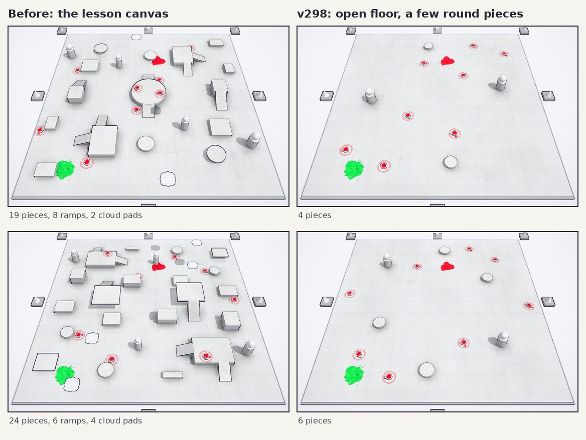

# v298: the first match is on an open Blank Canvas

The first match (the lesson) always plays on Blank Canvas. Until now it was laid out like any easy Blank Canvas, so a new player
learning to steer had a full obstacle course in the way: often a raised centrepiece with ramps, plus towers, walls, corners,
blocks, floating pads and drifting cloud platforms.

## What the lesson canvas looks like now

- An open floor with 4 to 6 round pieces on it: a pair of the Blank Canvas columns (the tall white posts with a ball on top) and
  one or two pairs of low drums.
- No centrepiece, ramps, holes, floating decks or pads, and no cloud platforms.
- Only round pieces, so nothing has a corner to snag on.
- The pieces are spread out:
  - at least 11 apart from each other;
  - none within 8 of the middle;
  - none within 6 of the edge.
- The refill tanks and the boiling puddles spread out over the floor. On a busy canvas they settle against walls. On this one that
  would have put them two to a drum.

## Before and after, over 60 generated lesson canvases each

| | Before | v298 |
|---|---|---|
| Pieces | 15 to 30 (21 on average) | 4 to 6 (5.2 on average) |
| Floor taken up by pieces | 5.4 to 13.3% | 0.4 to 1.9% |
| Ramps per canvas | about 8 | 0 |
| Cloud platforms per canvas | about 3 | 0 |
| Tanks right against a piece | 85% | 2% |
| Canvases that came out valid on the first try | 60 of 60 | 60 of 60 |

## Only the lesson

- Every other Blank Canvas match is laid out as before, easy ones included.
- The canvas waiting behind the menu is never the flat one. The lesson always lays out its own.
- "Same canvas" replays a flat layout as it was.

## Checked

- The lesson starts on a flat canvas.
- The lesson steps that look for open floor have more room now: the basin coming up ahead of you, and the roll-over lane.
- Steering and jumping in the lesson work as before.
- The menu canvas is unchanged.
- The release boots clean.
