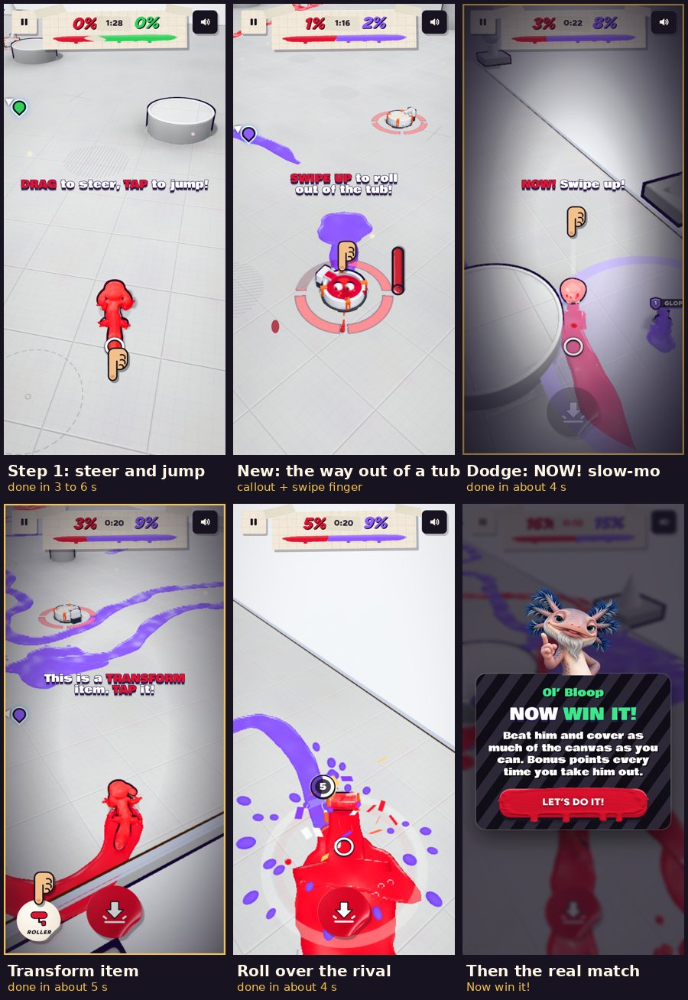

# v303: the first lesson, played through

The first lesson match was played end to end several times by a scripted player using real touches. It reads each tip, waits a human reading time (1 s plus 0.1 s a word past six), then does what the tip says: drag, tap, hold and pull, flick up, or tap the buttons. Every tip, step time, knock-out and screenshot was logged.

## Verdict

- **Plays as intended:** yes, when nothing goes wrong. Four failure paths broke it; all are fixed in v303 (below).
- **Easy to understand:** yes.
  - Each step is one short instruction in big type, with a finger on the control to use.
  - Longer explanations sit in Ol' Bloop's bubble.
  - Slow motion appears only at the timing moments: the fling, the pound, the "NOW!" dodges, and the item button.
- **Not babying:**
  - Tips go as soon as you act; the steer tip fades the moment you start steering.
  - Praise is one word.
  - A finished step hands straight on to the next.
  - Most steps took 3 to 10 seconds.
- **Fun and engaging:** a new thing every few seconds, nearly all of them aimed at the rival:
  - pound him;
  - dodge his pound;
  - flatten him with the roller;
  - ride a rocket onto him;
  - dodge his rocket;
  - grab a gift;
  - then "Now win it!" and a finale that ends on your own rocket blast.

## What went wrong, and the fixes

1. **A slow first drag left you stuck.**
   - **What happened:** resting a finger for more than 150 ms counts as "hold to stop". A drag that started after such a pause kept you braked, turning on the spot, until you lifted the finger. This hits the very first tip, "DRAG to steer".
   - **Fix:** a clear sideways drag out of a hold you haven't pulled now releases the brake and steers. Holding still still stops you. Once you pull down for a fling, a sideways drag still aims it, and letting go still flings. All four cases were checked with touches on v302 and v303.
2. **Knocked out mid-lesson, you sat in a tub with no way forward.**
   - **What happened:** after a knock-out you come back in a paint tub, but the lesson said nothing about getting out. The step's own tip stayed up; in the item step, "TAP it!" pointed at a button that is hidden while you're in a tub. The step timed out while you sat there, and so did the steps after it.
   - **Fix:** the step now waits with its clock stopped, and a "SWIPE UP to roll out of the tub!" callout shows with the swipe finger. Once you're out, the step's tip comes back. In the free play at the end, the callout shows whenever nothing else is being said.
3. **Most knock-outs were falls off the edge while reading a slow-motion tip.**
   - **What happened:** a tip pops up and you keep crawling while you read it.
   - **Fix:** in the taught steps the canvas edge is now a soft rail. Crawling or rolling up to the drop stops you at the brink and turns you back toward the middle; this was checked at the canvas corner. The free match at the end of the lesson and every later match keep the edge as it is.
4. **Coming back from a fall straight into a tub ticked off the paint-tub step unseen.**
   - **Fix:** that step now counts only a tub you roll into after running dry.

## Step times on v303 (game seconds, from the playthroughs)

| Step | Time |
|---|---|
| Steer and jump | 3 to 6 |
| Fling | 4 to 5 |
| Roll into a paint tub when dry | about 4 |
| Burst out and pound the rival | 7 to 9 |
| Dodge his pound | 2 to 4 |
| Tap the transform item | about 5 |
| Roll over him | 4 to 9 |
| Orb and rocket | about 10 |
| Dodge his rocket | 10 to 25 (longest when a tub came in between) |
| Grab the gift | about 15 |

The whole lesson match, finale included, took about 2.5 minutes.

## How it was tested, and a note on the test machine

The test machine draws only about two frames a second in software. At that rate a quick drag reaches the game as a hold, and a tap as a long press, so the playthroughs skipped the main 3D draw while playing (frames every ~30 ms, like a phone) and drew it only for screenshots.

Things that turned out to be the test player's fault, not the game's:
- **Edges:** it didn't avoid them at first.
- **Tub entry:** it rolled at tubs with up to 20 degrees of aim error, but you enter a tub by passing within about a metre of its centre.
- **"NOW!" timing:** its screenshots were eating the short "NOW!" windows.

Those were fixed in the test player and are not game changes.

Not changed, but worth a look:
- **Slow motion in 6 of the 11 steps.** It makes the timing moments readable, but a confident player may find it slow; it could be dropped for the second time a move comes up.
- **Wandering into a tub by accident.** Crawling over any tub that still has paint drops you into it. In one playthrough that happened six times, each time bringing up the new callout.
