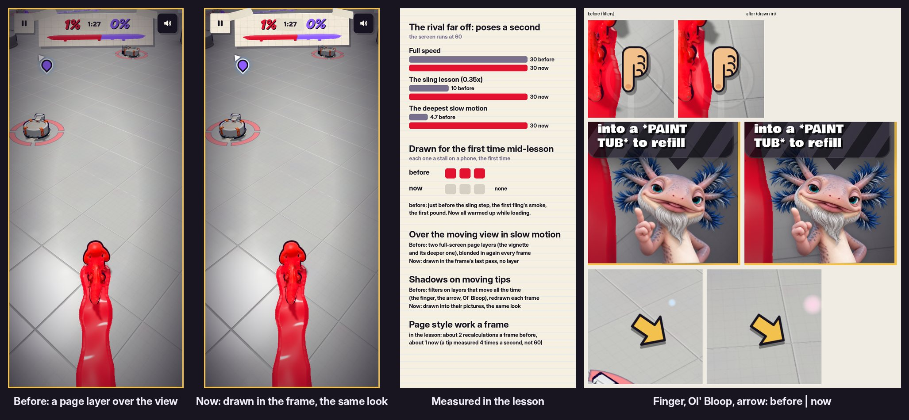

# v332: the first lesson runs smoothly through the slingshot and the other slow-motion parts

The lesson's slingshot step lost frames on a phone. The step itself runs no heavier game code than the rest of the match (measured: the same script time, no shaders made mid-lesson), so the drops came from what the lesson adds on top of play. Five things, all fixed:

## 1. The slow-motion vignette is drawn in the frame
- **Before:** while a tip waits on you, the game slows down and the edges darken with a gold frame. That was a page layer covering the whole screen, over the live 3D view, plus a second one for the deeper slow motion. A phone blends every such layer in again each frame, and paints it whole each time it appears.
- **Now:** it's drawn in the frame's last pass, the way the low-paint and hit edges have been since v293. Same gradients, gold frame and fades, in Graphics and in Performance mode.
- **The one visible difference:** it now sits under the HUD rather than over it, so the score bar and buttons stay bright at the edges.
- This covers every slow-motion moment: the slingshot, the first pound, the missile, the dodges, the roller, the rocket dodge, and the sun's warning in the first real match.

## 2. The rival moves smoothly in slow motion
- A character far off works out its pose 30 times a second instead of every frame (v296). That was 30 a second of game time.
- So in the sling step's slow motion the rival's limbs, ears and face stepped 10 times a second, and under 5 in the deepest slow motion, while the screen ran at 60. It looked like dropped frames.
- **Now** it's 30 a second of real time.
- **Measured:** 30, 30 and 30 a second (before: 30, 10 and 4.7).

## 3. First-time effects are set up while loading
- **The cause:** the warm-up at the end of loading draws everything once, so the phone has set up how to draw it before play. Effects that start empty drew nothing: the smoke puffs behind a fling, paint drops, splashes, sprinkles, and the floor's paint before any is laid. So the phone set each one up the first time it turned up, mid-match. In the lesson, that's the first time you do each thing.
- **Measured in the lesson:** three such first draws.
  - Just before the sling step.
  - The first fling's smoke.
  - The first pound.
- **Now** the warm-up draws each of them once, plus the slingshot ball's lower-detail spheres (used when it's small on screen in flight). A full run of the lesson shows none of those first draws mid-match.
- **Still made on the spot:** the rocket's jet drops (one pool per team), but with a program the phone has already built. No shader is built anywhere in the lesson.

## 4. Shadows drawn into the tips' pictures
- **Before:** the finger that shows a gesture, the arrow to a basin and Ol' Bloop in his corner had their shadows as filters on layers that move all the time. A phone redraws those every frame.
- **Now:**
  - The finger's and the arrow's shadows are part of their drawings.
  - Ol' Bloop's soft shadow is drawn into his picture once, when the game starts.
- They look the same (see the picture).

## 5. Smaller things
- **Tip placement:** in a match, a tip's place is measured 4 times a second, not every frame. Each measurement made the page lay itself out again mid-frame. Style recalculations in the lesson went from about 2 a frame to about 1.
- **The slingshot band** measures the screen once a pull, not on every finger move.
- **The music's slow-motion muffle** ends on its value when it's done, so the filter isn't recalculated sample by sample for the rest of the session.
- **Restart Game** now keeps how the phone's graphics settled, as it already kept the graphics choice. A replayed lesson no longer retunes the graphics mid-lesson, which made the picture step down (and hitch) in its first seconds. Progress is still wiped and the lesson comes first.

## Tested
In the preview build, on a 390px-wide phone:

**The fixes:**
- **The vignette, on the same frozen frame, new against old:**
  - Normal and deeper: within 2 to 6 levels of 255 in both modes.
  - The darker one (first real match): its gold frame is up to half a pixel softer when the 3D view runs below screen resolution.
- **The rival in slow motion:** 30 poses a second.
- **First draws mid-lesson:** before, three. Now none of those (the two rocket pools reuse a program already built), and no shader built in the lesson.
- **The full-screen vignette layer** is gone from the sling step's layers.
- **Restart Game:** keeps the graphics steps and the choice, and still starts over (4 checks).
- **The whole lesson,** played with real touches from the first steer to the end of the match: every step done, no page errors.

**Earlier suites:**
- The v331 portrait checks pass (43/43).
- The v330 eye and gift checks pass (45/45).
- The v328 tap checks pass (26/26).
- The v327 locker checks show the same four old-flow failures as before this change, on each screen size, and nothing new.
