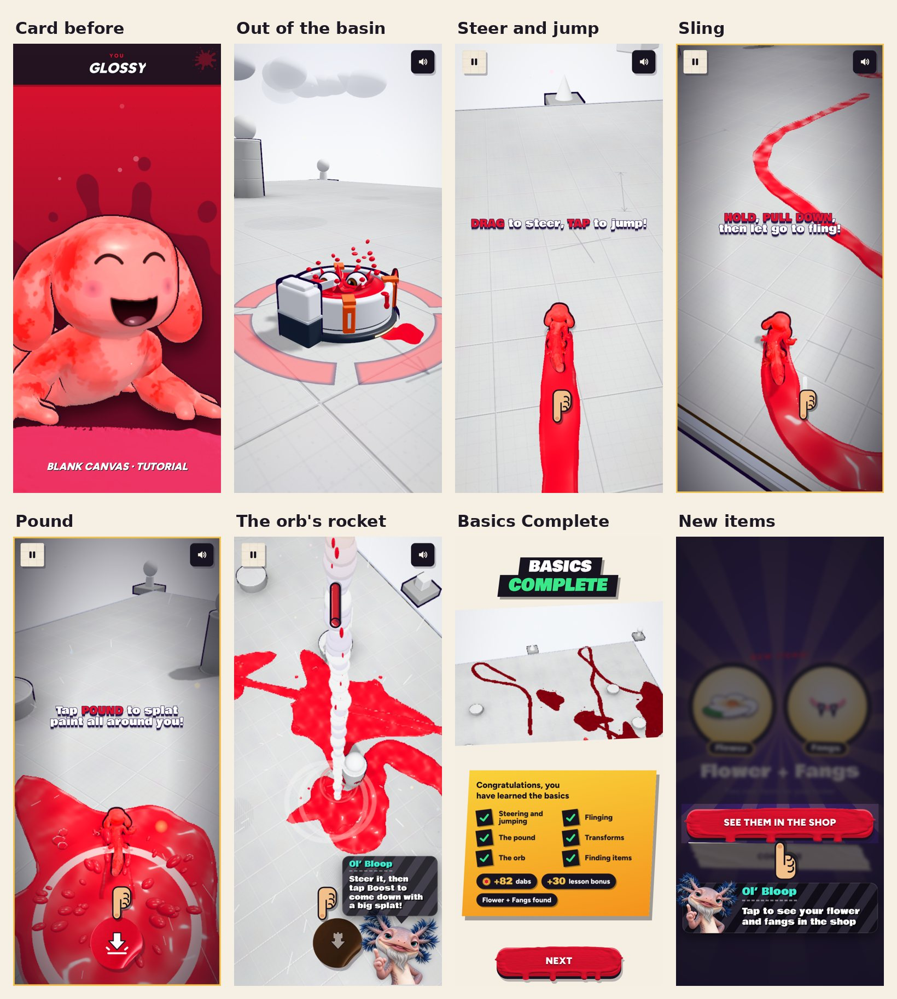
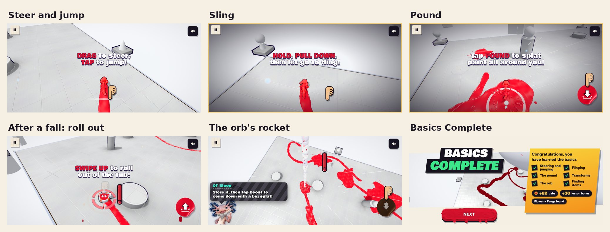

# v356: the first lesson, on your own

- **No rival.** The lesson is you alone on the Blank Canvas, as in a Time trial. The card before it shows only you, and
  reads "Blank Canvas · Tutorial".
- **One basin: yours.** You crawl out of the basin you start in, as before. It sinks once you're clear of it. No other
  basins appear in the lesson, and the ones that are gone stay gone.
- **No timer and no coverage.** The bar at the top (both percentages, the clock and the strip) is hidden for the lesson.
  Pause and sound stay where they are.
- **No "Full tank! Tap POUND to burst out".** The refill step is gone, and your tank stays full for the whole lesson.
- **The steps now:**
  1. Steer and jump.
  2. Fling with the slingshot.
  3. The pound: once you've landed from the fling, its button comes up and the tip points at it. Any pound counts,
     with no rival to aim at. (It waits for the landing because in the air after a fling the same button fires a
     missile, which isn't what the tip describes.)
  4. The Roller (a Transform): tap its button.
  5. The orb: roll into it, steer the rocket, then tap Boost to come down with a big splat.
  6. The gift: grab the flower.

  Gone, because they needed a basin or the rival: refilling at a basin, pounding the rival, dodging his pound,
  flattening him with the Roller, and dodging his rocket.
- **The finish:** Basics Complete lists the six things you learned, with your dabs and the lesson bonus. Next shows the
  "New items!" card for the flower and the fangs, which goes on to the Paint Shop as before. There's no score count or
  victory screen, since there's nobody to beat and no coverage to count. Your dabs, rank points and stats are counted
  as before.
- **Knocked out mid-lesson** (only by falling off the edge now): you come back in a basin that rises for you, the
  "SWIPE UP to roll out of the tub!" callout shows the way out, and the basin sinks once you're out.
- **The dashboard** lists the new steps in its tutorial funnel (`admin/catalog.json`, and `_tut_steps()` in
  `supabase/migrations/20261018000000_liveops.sql`). Players who took the old lesson still count at the steps both
  lessons share.

## Tested
Played start to finish by the scripted touch player (it reads each tip, waits a reading time, then drags, taps, holds and
pulls, or taps the buttons): four times, two upright and two sideways, from the lobby's Play button to the Paint Shop. In
every run all six steps were done and none timed out, and the page had no errors. At every check (one every 60 ms or so
of play) there was:
- nobody in the match but you;
- at most one basin showing (none after the first seconds, except the one you came back in after a fall);
- no top bar.

The first two runs found two things, both fixed before the last two, which also checked that the pound tip never shows
over a missile button:
- Ol' Bloop's rocket tip showed the asterisks around "Boost".
- The pound tip came up while you were still in the air from the fling, when that button fires a missile.

Also checked:
- **A fall mid-lesson (forced, sideways):** you come back in a basin, "SWIPE UP to roll out of the tub!" shows, and once
  you're out the step's own tip returns and the lesson goes on.
- **The card before the lesson:** only you, titled "Blank Canvas · Tutorial".
- **After the lesson:** Basics Complete, then New items, then See them in the shop opens the Paint Shop with Ol' Bloop's
  "Looking good! Buy it", exactly as before.

| Step | Time (game seconds) |
|---|---|
| Steer and jump | about 4 |
| Fling | about 4.5 |
| The pound | about 3.5 |
| Tap the Roller | about 5 (9 with the forced fall) |
| The orb and its rocket | 8 to 13 |
| Grab the gift | 11 to 14 |

The whole lesson match now takes about 45 to 50 seconds (it was about 2.5 minutes with the rival and the basins).
