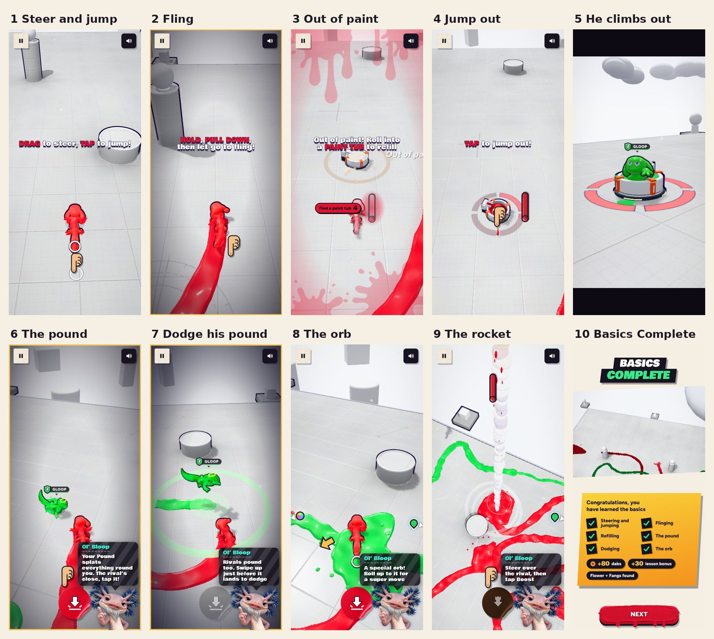
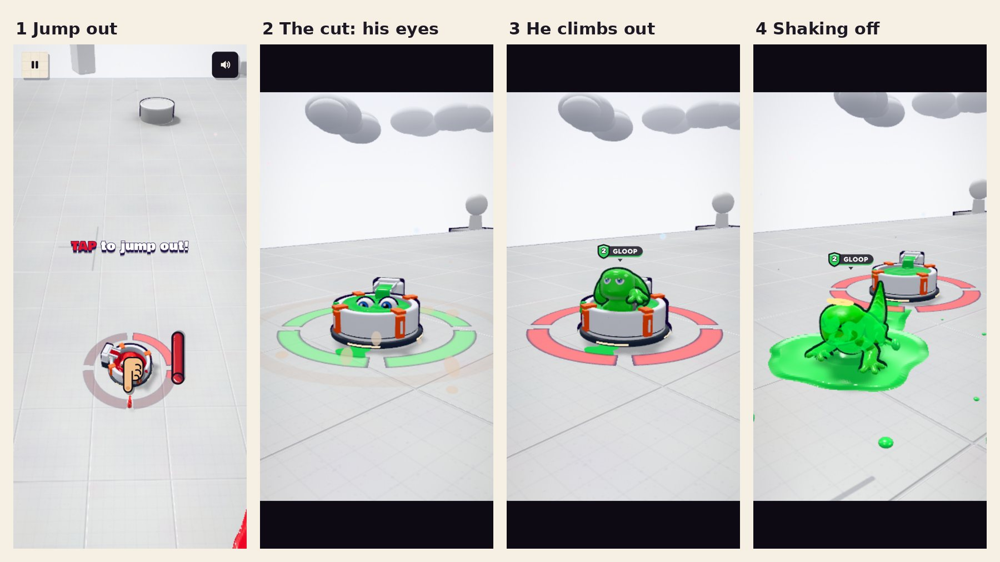
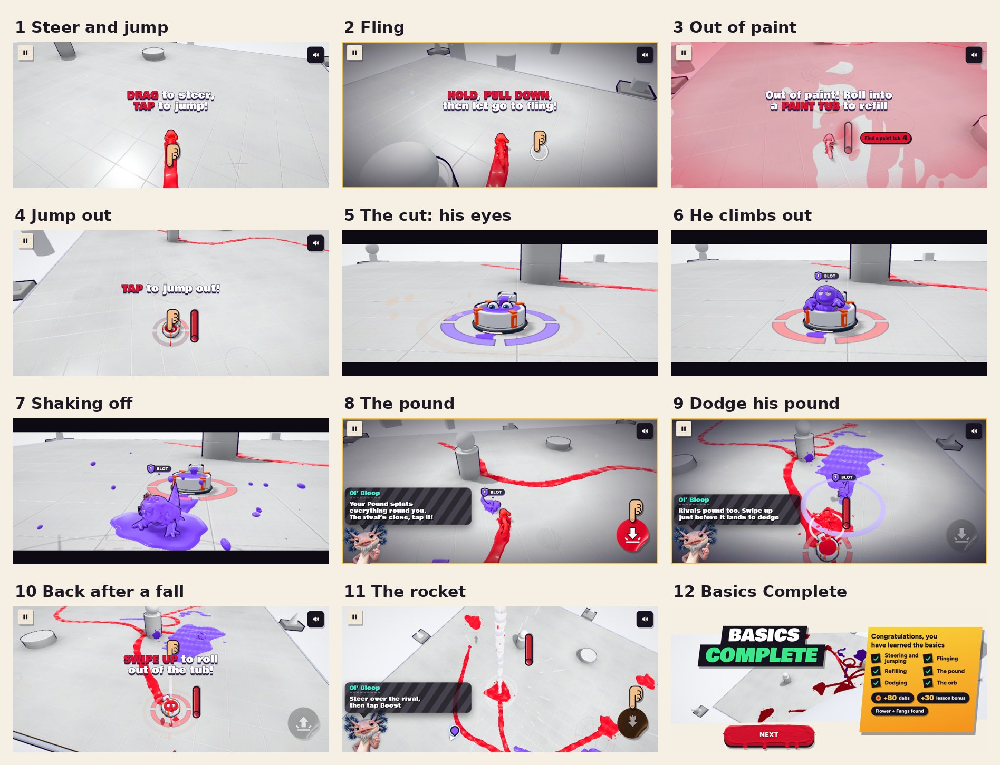

# v357: the lesson, with a refill and the rival's entrance

- **Move, jump and sling on your own**, as in v356: only you on the Blank Canvas, no timer and no coverage.
- **Out of paint:** your tank empties and one basin comes up a few steps ahead of you. "Out of paint! Roll into a PAINT TUB
  to refill" shows, the arrow points at it, and after a moment the finger shows the swipe up (a roll gets you there faster). It's
  the only basin showing.
- **Jump out:** in the basin your tank fills up, then "TAP to jump out!" shows with a finger tapping (with a keyboard, "Press
  SPACE to jump out!"). Stay in it and you hop out on your own after 9 seconds.
- **The rival's entrance:** you land and stop, and the controls go for a moment. Then the view cuts (black bars in, no
  buttons) to a second basin about nine metres ahead of you, turned so he climbs out on your side. The rival's eyes peek out of
  his paint, he climbs out the way you do at the start of a match and shakes himself off (the view eases back as he comes
  toward it, so he stays in the picture), then the view cuts back to you, turned to face him. It takes about 6 seconds. Held sideways the shot uses a longer lens, so he fills the frame about as
  much as he does upright.
- **The ground pound:** he comes over, and once he's in reach the tip points at the pound button. Knocking him out or
  flattening him does it. (Still in the air from the sling, the button fires a missile: close to him the tip says so, further
  off it waits until you're down.)
- **Dodging:** he pounds back. "Rivals pound too. Swipe up just before it lands to dodge", then "NOW! Swipe up!" as it's
  about to land, with the game slowed right down.
- **The special orb, and that's it:** roll into it, steer the rocket over him and tap Boost. When you're down the lesson
  ends.
- **The finish:** Basics Complete lists Steering and jumping, Flinging, Refilling, The pound, Dodging and The orb, then the
  "New items!" card goes on to the Paint Shop, as in v356.
- **Gone from v356:** the Roller step and the gift step (the lesson stops on the orb now).
- **Two basin controls fixed (everywhere, not just the lesson):**
  - A swipe up to roll into a basin that only registers once you're already in it no longer rolls you straight back out.
    A swipe that starts once you're in still rolls you out.
  - A slow tap in a basin now hops you out. A press held past 0.15 s starts aiming a fling, and letting go without
    pulling used to do nothing, so a deliberate "TAP to jump out!" could leave you sitting there. A still press under
    0.45 s now counts as a tap; a longer one let go without pulling still does nothing, and pulling still flings you out.
- **Basins:** a basin nobody is in and nobody is near sinks, so no more than three ever show (in practice one or two). Your
  tank and his stay full except in the refill step.
- **The dashboard** lists the new steps in its tutorial funnel (`admin/catalog.json`, and `_tut_steps()` in
  `supabase/migrations/20261018000000_liveops.sql`).

## Tested
Played start to finish by the scripted touch player (it reads each tip, waits a reading time, then drags, taps, holds and
pulls, or taps the buttons), from the lobby's Play button to the Paint Shop, nine times, upright and sideways, on the builds
as they were fixed. Every run got through every step with none timed out, and the page had no errors. At every check (about
one every 60 ms of play) there was:
- nobody but you in the match until the entrance, and the rival in it after (or knocked out);
- you held still, with the bars in, through the entrance;
- no bars left on, and no more than three basins showing;
- no top bar, and never the pound tip over a missile button.

The runs found three things, all fixed and checked again before the final runs:
- **The rival walked into the camera.** The last shot of the entrance had him cut off at the edge of the screen, as he
  climbs out toward it. The view now eases back and turns with him.
- **A swipe into the basin rolled you straight back out.** It began outside, but by the time it registered you were in,
  and in a basin a swipe means roll out, so "TAP to jump out!" never showed.
- **A tap didn't hop you out.** The page saw it last just over 0.15 s, so it became a press aiming a fling, and letting go
  without pulling did nothing (the 9-second fallback hopped him out instead). One later tap that took 0.2 s now hops out.

Both control fixes also have their own checks (a swipe or a press sent straight to the page in a match, upright). The check
for each fix failed on the build before it, and all of them pass on the final build:
- **Swipe:** a swipe begun outside and landing just after you're in leaves you in; one begun in the basin rolls you out; so
  does one from a finger held still since before, once you've been in a while; out in the open a swipe still rolls you.
- **Press:** in a basin a quick tap and a 0.25 s press both hop you out; a still 0.7 s press let go leaves you in; a press
  pulled down flings you out.

The final runs (the last sideways one on the final build; the upright one on the build before it, which differs only in
the sideways lens), from Go:

| Step | Upright | Sideways (forced fall in the dodge) |
|---|---|---|
| Steer and jump | 5.1 s | 4.3 to 4.9 s |
| Fling | 4.6 s | 4.0 to 4.4 s |
| Out of paint, into the basin | 7.2 s | 5.1 to 7.4 s |
| Jump out and the entrance | 8.7 s | 8.6 to 8.9 s |
| The pound | 3.5 s | 3.6 to 3.7 s |
| Dodge his pound | 3.6 s | 6.3 to 6.6 s |
| The orb and the rocket | 22.6 s | 11.2 to 12.3 s |

The whole lesson match takes about 48 to 59 seconds. Also seen in the runs: falls off the edge before the refill (you come
back in a tub, swipe out, and the step goes on), and the refill basin coming up behind you when you're still sliding from
the fling (the arrow turns you round; it took one run 12.9 s).

After the lesson: Basics Complete lists the six things, then New items (the flower and the fangs), then See them in the
shop opens the Paint Shop with Ol' Bloop's "Looking good! Buy it", as before. The earlier tests (the v352, v351, v355 and
v354 checks, and the dashboard's end-to-end and live tests) pass on the final build.
