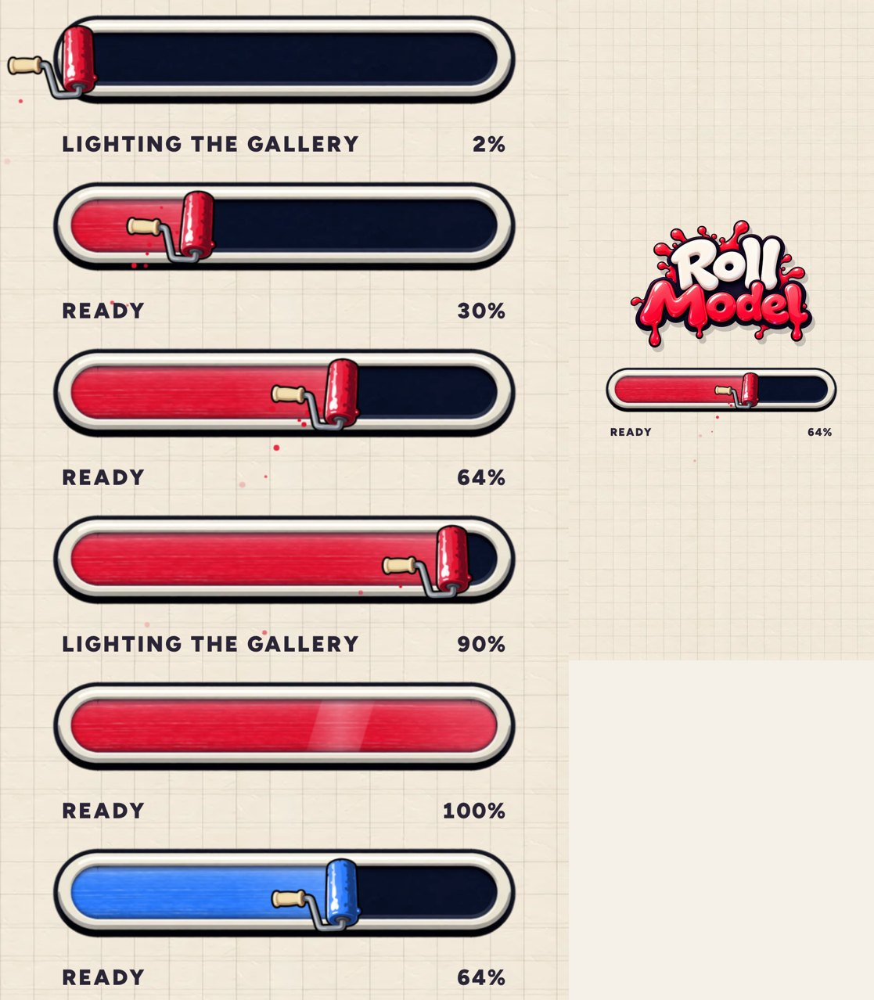

# Premium loading bar (v278)

The loading screen's bar used to be a white box with paint drawn in code. It's now made from Ludo.ai art. Built in
`tools/v278_bootbar.py`, with the pictures in `tools/assets/boot_*.webp`.

## What's in it

- **The frame (Ludo):** a cream capsule with a chunky glossy rim and a thick dark outline, around a deep navy track. It's drawn in
  three slices, so the round ends keep their shape at any width.
- **The paint (Ludo):** the streaks of a real paint-roller stroke, laid over your own ink colour. It's lit along the top and
  shaded along the bottom so it looks rounded and glossy, is wetter near the roller, and a shine sweeps along it every few seconds.
  The track's inner shadow sits over it, so it looks poured in.
- **The roller (Ludo):** a paint roller stood upright, riding the front edge and pushing the paint along. Its paint is recoloured
  to your ink. It bobs on the track, leans in when it hurries, flings a few flecks and the odd drip, and lifts away when the bar
  is full.
- **Underneath:** the loading message on the left and the percent on the right. On "Tap to start" the message is centred and the
  percent hides.

## Notes

- The paint keeps up by real time, not frames: loading keeps the page busy and frames come slowly, so it would otherwise fall
  behind and still be part-filled when the screen fades.
- The pictures are embedded in the page (about 90 KB), so the bar is ready the moment the screen shows.
- If drawing fails for any reason, the old plain fill comes back.
