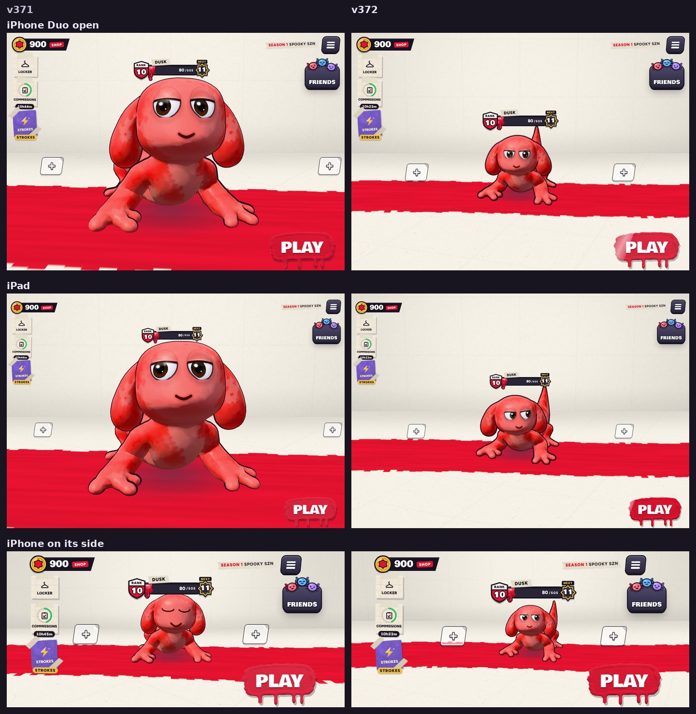

# v372: the lobby held sideways is a line-up seen from well back

## What was wrong

Held sideways, the lobby's camera stood close to the character with a wide lens (38 degrees). On iPhone Duo open, an iPad or a
computer the character filled half the screen or more, its head bulged toward the camera, and the + spots for party members were
pushed out to the screen's edges.

## What it does now

- **A long lens from well back.** Held sideways (any screen wider than it is tall), the camera stands about three times as far back
  with a 24 degree lens, so the character keeps its shape and is much smaller: about a quarter of the screen's height on iPhone Duo
  open and an iPad (it was half), a little under 30% on a phone on its side and on computers.
- **A line-up with room for your party.** You stand in the middle with a + spot either side, a little further out than before, so
  three characters would stand clear of each other. The three take most of the width the side buttons leave beside them and stand in the
  middle of the free space, a little low, with the rank bar over your head. Where a side button reaches down beside you (iPhone Duo
  closed, a phone on its side) the line-up keeps clear of it and centres in what's left.
- **The camera looks down a little more** (about 13.5 degrees instead of 7.5), so the floor still shows from further back.
- A hat doesn't make your character smaller unless the screen is short (a phone on its side), where the hat has to fit too.
- Upright, nothing changes.

## Tested

- **Sideways, at 12 sizes** (iPhone SE, iPhone and iPhone Pro Max on their sides with their safe areas, iPhone Duo closed and open,
  iPad mini, iPad, iPad Pro, laptop, desktop, a 1920 x 1080 window and a near-square one), with no hat and with the tallest hat
  (the witch hat): the lens is 24 degrees, your body is 18% to 30% of the screen's height, and you, a character standing on each +
  spot and the + spots themselves are clear of every lobby button and of the rank bar, inside the safe area. 24 of 24.
- **Upright** (iPhone, iPhone Duo open, iPad): the camera is where it was in v371. 3 of 3.
- **iPhone Duo partly folded:** v371's fold checks still pass on this build (66 of 66): the rank bar stays right of the fold, the
  + spots are either side of it.
- **The earlier tests** pass on this build: the v352 checks (25 of 25), v351's two (26 of 26, 7 of 7), v355's (27 of 27) and
  v354's (25 of 25), the dashboard's end-to-end (38 steps) and live tests (13 steps), and the database tests (53 of 53).
- **Turning iPhone Duo open** between wide and upright in the lobby switches between the line-up and the upright framing and back.
