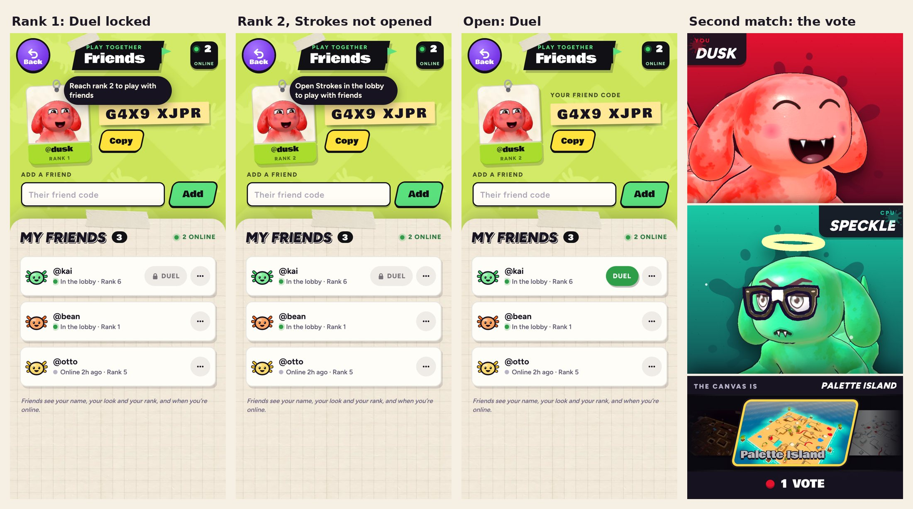
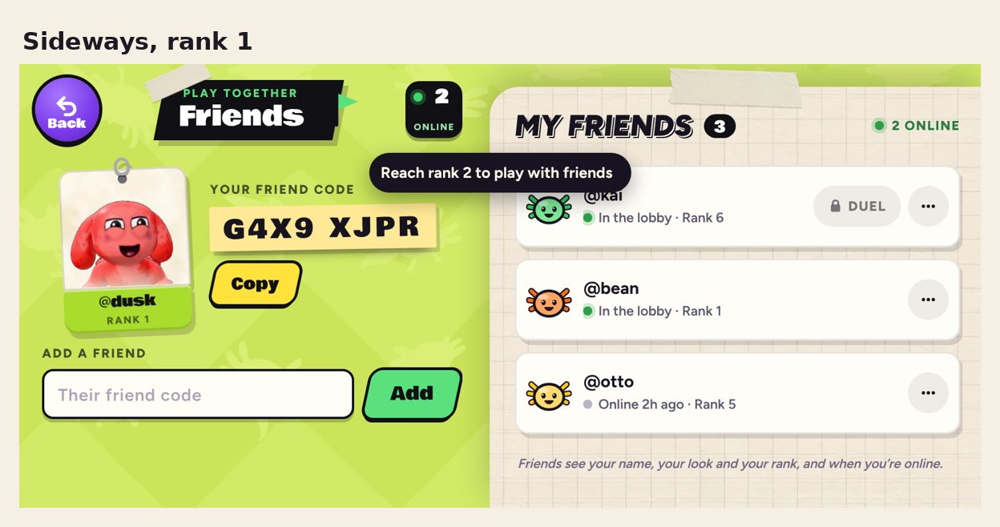

# v359: friends open with Play online, and the second match's canvas is a plain vote

## Playing with friends

Playing with friends now opens when Play online does: at rank 2, once you've seen the Strokes page (it comes up when you
reach rank 2). Play online (matchmaking) was already locked this way, and Showdown and Time trial still open at rank 2.

Until then:

- **A friend's Duel button shows a lock.** Tapping it says "Reach rank 2 to play with friends", or, at rank 2 before
  you've opened Strokes, "Open Strokes in the lobby to play with friends".
- **A friend under rank 2 has no Duel button.** They can't play yet either.
- **A duel invite that comes in is turned down for you** and never shows. The friend who sent it sees "can't play right
  now", the same as when someone says no.
- Adding friends, answering friend requests and seeing who's online work as before.

Also fixed: if you opened Friends in the second before Ol' Bloop's rank 2 card ("Look at you, rookie!"), the card came
up over the Friends page, and its Show me opened Strokes underneath it. His rank 2 and rank 3 cards now wait while the
Friends page is open and come a beat after you close it.

## The second match's canvas

The second match is no longer set to Sludge Sewer. Your vote (the canvas you picked) and your rival's go in, and the
one with the most votes is drawn; a tie is drawn at random. In a 3-way, three votes go in. The second lesson match's
tips (sun, shade, missiles) run on whichever canvas lands. This replaces v358's note that the second match is on Sludge
Sewer.

## Tested

A probe (18 checks, all passed):

- Three second matches: each time the canvas drawn was one of the two votes (for example Palette Island, Fishing Raft
  and Palette Island again), your vote counted, and the lesson match ran.
- Rank 1: the locked Duel button and its message, no button for a friend under rank 2, no invite sent, and an incoming
  invite turned down and not shown.
- Rank 2 before Strokes: still locked, and the message says to open Strokes.
- Open (rank 2, Strokes seen): the real Duel button, and invites show as before.
- No page errors.

A second probe (10 checks, all passed) covered Ol' Bloop's cards: with Friends open at rank 2 no card comes; after Friends
closes the card comes about 1.2 seconds later; Show me opens Strokes on top with the lesson running; with nothing open
the card comes as before; and the rank 3 card waits for Friends the same way.

The Friends page was also checked upright and sideways with nothing off the sides. The earlier tests (the v352, v351,
v355 and v354 checks, and the dashboard's end-to-end and live tests) pass on this build.
