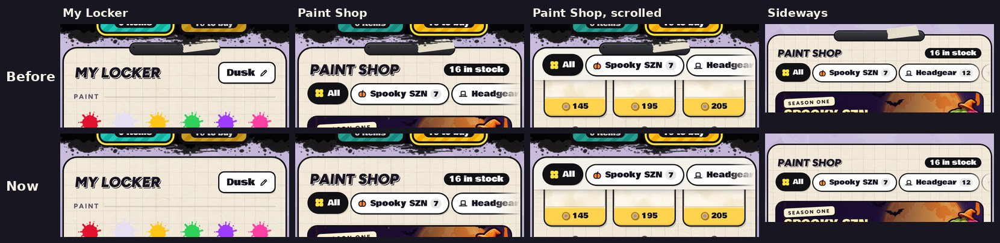

# v338: the locker's sheet without the black bar and tape

- **The sheet under the locker's window hung from a black rounded bar with a strip of tape across it.** It's gone, for a cleaner look. Only the sheet's own top edge is left.
- **This applies to My Locker and the Paint Shop,** upright and sideways.
- **Nothing else moves:** the heading, the filter row (still held at the top as you scroll) and the cards sit where they were.
- **The Strokes page keeps its bar.**

## Tested
In the preview build, on a 390px-wide phone and sideways:
- **The top of the sheet** in My Locker, the Paint Shop, the Paint Shop scrolled, and sideways.
- **The Strokes page** still shows its bar.
- **The v333 Paint Shop filter checks pass (41/41):** the filter row is still held at the top as you scroll.
