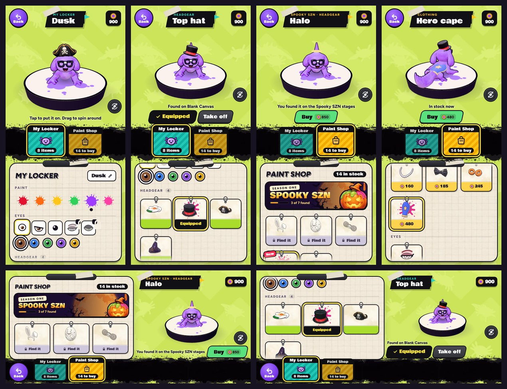

# v327: My Locker and the Paint Shop, one page

The locker and the Paint Shop are now one page, built on the Strokes page, with the locker's graph paper for the panel.

## The page
- **The wall, Back and the taped banner** are the Strokes page's own. The banner names what you're looking at.
- **Your dabs** are at the top right. Tapping them opens the shop.
- **The window** shows you on a small pad: the game's own character, in your paint, wearing what you have on.
  - Drag to spin yourself round. After a moment you turn back to face the front.
  - The round button turns you to show your back.
  - Tap yourself for a hop.
- **Two tabs** sit on the ink band:
  - **My Locker** shows your face and how many things you own.
  - **Paint Shop** shows the bag and how many things you can buy.
  - A red dot on a tab means something new is in it.
- **The panel** is the locker's graph paper, with the locker's headings.

## My Locker
- **Your name** is at the top, and you can change it there.
- **Paint:** your six colours. A new one splashes onto the pad as you hop.
- **Eyes:** the styles, then their colours.
  - The camera moves in on your face when you change them.
  - A locked style takes you to the shop and puts it on you to try.
- **Headgear, Facial and Clothing:** what you own, as hang tags.
  - A tap puts it on, and its strip says Equipped.
  - "Take off" sits beside Equipped.
  - New things say New until you wear them.
  - If you own nothing in a part, it says so and links to the shop.
- **The "Unlock all items" code** is at the foot of the paper.

## Paint Shop
- **What's for sale:** the Spooky SZN finds come first, under their banner with "N of 7 found". Then come Headgear, Facial, Clothing and Eyes.
- **Each tag** shows its price, or a lock and "Find it" if you haven't found it yet. A price you can't reach yet is greyed.
- **A tap tries it on,** so you see it on yourself straight away.
  - Things for your face bring the camera in close.
  - The cape turns you round to show it.
  - The flower and the floaties turn you to the side.
- **Buy** pays for it, keeps it on and puts it in your locker.
  - If you can't afford it, the button shows the price, and a note says how many more dabs you need.
  - If it's locked, the button says "Find it", and a note says where.
- **Trying on ends** when you leave the shop tab or the page, and anything you didn't buy comes off.

## Ways in
- The lobby's locker button opens My Locker. The dabs counter opens the Paint Shop.
- A new find's "See it in the shop" opens the shop with the find on you.

## The lessons
- **After the first lesson match:**
  1. "Open the Paint Shop".
  2. "Tap the flower to try it on", then "Buy it".
  3. The fangs the same way.
  4. Bought things stay on, so next comes "Open your locker".
  5. Then "Take a look around", with the finger on you to spin.
- **If the fangs come off,** the locker lesson asks you to tap them.
- **The zombie eyes** after the first real match: "See it in the shop" tries them on, and Buy puts them on.

## Also
- **The Strokes page's demo** now always shows your current paint. Before, it kept the colour you had when it first loaded.
- **Enter, Space and W** no longer start a match from under another page. Only the canvases page starts one.

## Tested
In the preview build, on 390px, 320px and 430px-wide phones and sideways, 173 checks, all passing:
- **The page:** it opens from the lobby with you in the window, and nothing runs off the screen. The lobby doesn't draw under it.
- **The locker:** a tap puts things on, one per part as before. Take off and Equip work. Wearing a thing clears its New tag.
- **Paint and eyes:** paint, eye style and eye colour all change, on you too. A locked eye style opens the shop with it on you.
- **The shop:**
  - A try-on stays off your saved look.
  - It comes off when you go back to the locker.
  - The dabs badge opens the shop.
  - Buying pays, keeps it on and saves it.
  - The can't-afford and locked states show the right button and note.
  - The shop tab's dot goes once you've seen the new find.
- **The window:** the round button turns you to show your back, and a drag spins you.
- **Closing:** Back and Escape both close the page, and what you bought stays on.
- **The Strokes page** works as before after visiting the page: the rival, the full pad and your paint.
- **The lessons:** the flower and fangs lesson, the fangs in the locker, and the zombie eyes from "See it in the shop" all run on the new page.
- **No page errors.**
