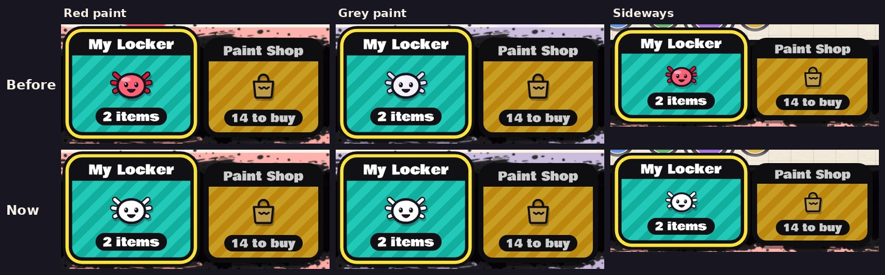

# v339: the My Locker tab shows the drawn face, in white

- **The My Locker tab** (on the locker page, beside the Paint Shop's) **shows the drawn axolotl face again,** not your portrait.
- **It's white whatever your paint.**
- **Everything else that shows your portrait keeps it:** the lobby, the Friends page, Match found and the results.

## Tested
In the preview build, on a 390px-wide phone and sideways:
- **The tab in red paint and grey paint, and sideways:** the white drawn face, with the item count under it.
- **It stays the drawn face** after your portrait has had time to be made.
