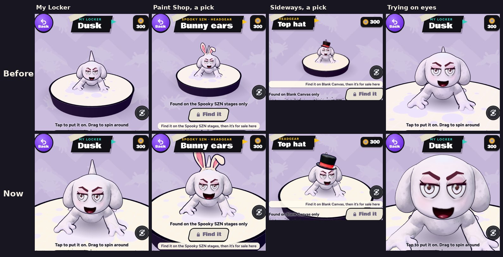

# v337: the locker zoomed in 2x on your character

## What was wrong
- **The window framed the whole pad,** with your character small in the middle of it.
- **A pick in the Paint Shop made you even smaller.** Its words and button under the window take room, so the camera pulled back further. Your screenshot (Zombie eyes) was this view.

## What changed
- **The camera comes in twice as close** in every view of the locker page: My Locker, the Paint Shop, and with something picked, upright and sideways.
- **It aims at your character, not the pad.** You stay in the middle of the window with a hat on, and the pad's rim goes out past the window's edges.
- **A hop stays in the window.** When you poke your character and it hops, the camera rises with part of the hop.
- **The close-up when trying on eyes or something for the face comes in closer too,** so it still zooms in from the new view rather than out.
- **Unchanged:** the paint dive, spinning, the pokes, and the Strokes page's own window.

## Tested
In the preview build, on a 390px-wide phone and sideways:
- **My Locker, the face close-up, and picks in the Paint Shop** (Zombie eyes, Bunny ears, Top hat). Your character is twice the size, and a hat stays clear of the heading.
- **Spinning** side-on and from behind, **three pokes** (the hop stays in the window) and **the dive into new paint.**
- **The v328 tap checks pass (26/26):** a tap on your character in the locker still pokes it.
- **The v333 Paint Shop filter checks pass (41/41).**
- **The v333 wall checks pass (10/10):** the window's part of the wall still meets the page's without a seam.
