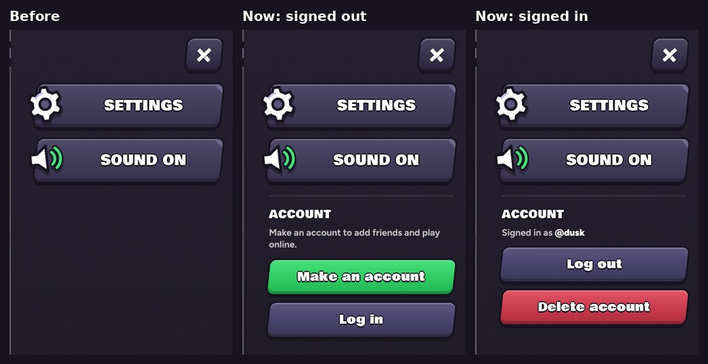

# v346: the account is in the menu

- **The Account section moved from Settings to the menu** that slides in from the right. It sits under Settings and the sound, below a thin line.
- **Signed out:** "Make an account to add friends and play online." with **Make an account** (green, like the Friends page's) and **Log in**.
  - Either one closes the menu and opens the account sheet over the lobby.
  - Closing the sheet puts you back on the menu button.
- **Signed in:** "Signed in as @you" with **Log out** and **Delete account**. Each still asks first:
  - Log out offers Log out or Stay.
  - Delete account offers Delete for good or Keep it.
  - Closing the menu and opening it again starts over.
- **Settings no longer has the Account row.** Everything else in Settings is unchanged.
- **Text that sent players to "Settings, Account" now points to the menu.** That's on the Friends board, in the Terms ("You can delete it any time from the menu") and in the Privacy Policy ("Menu › Account › Delete account").
- **Sideways,** the menu's buttons are a little shorter so the account fits under them. A longer message, like the one Log out asks, scrolls the menu a little.

## Tested
In the preview build, on a 390px-wide phone and sideways. 15 checks, all pass:
- **Where it is:** the section is in the menu, under the sound. It's no longer in Settings, and Settings doesn't mention Make an account.
- **Signed out:** the note, then Make an account and Log in. It fits upright without scrolling.
- **The sheet:**
  - Make an account closes the menu and opens the sheet on New account. Closing the sheet puts focus back on the menu button.
  - Log in opens the sheet on Log in.
- **Signed in:**
  - Signed in as @dusk, with Log out and Delete account.
  - Log out asks first (Log out, Stay), and Stay goes back.
  - Delete account asks first (Delete for good, Keep it).
  - Reopening the menu starts over.
- **Sideways:**
  - Signed out and signed in both fit without scrolling.
  - While Log out asks, its buttons can be reached by scrolling the menu.

The final Log out and Delete for good weren't pressed: they need the live account server, which the preview can't reach.
